# Studio QA + design audit — staging vs `main`

> **Read this first, before any Studio work.** This is the reference for what differs between staging and `main`: what is broken on staging, what is already fixed in `main` and where, and what is still open. Agents should load it before changing Studio, and the lead engineer can use it to see where each fix lives. Start with the Summary and "Staging re-check (2026-11-22)", then "Later fixes in Main".

- **Date:** 2026-11-18, about 11:35–11:57 (UTC+2). **Staging re-checked 2026-11-22, about 14:45–14:55**; see "Staging re-check (2026-11-22)" below the summary.
- **Staging:** `https://staging.llumen.io/studio?workspace=59f25e0c-…&workspaceType=private` (tab `0e2093`)
- **Main:** `http://localhost:5173/llumen-frontend/?studio=10` (tab `353cf4`; mock data)
- **Method:** Read-only. Emulation at 1440×900, 1280, 1024, 768 and 390. Computed styles read with `getComputedStyle`. Hover and focus states were forced with CDP `CSS.forcePseudoState`. Console output was captured by an in-page `console.warn`/`console.error` wrapper injected before load. Timing comes from a 50 ms DOM poller injected before load. Nothing was created, saved or edited. The Edit Asset wizard was opened once by accident (a coordinate click) and closed with its X.
- **Evidence:** screenshots are embedded inline. Open this file in Markdown preview (Cmd+Shift+V) to see them.
- **Scope note:** The parent agent added new Studio assets to local `main` by hot reload (tables, KPI grids, scatter, polar, range, score, analytics, map assets). Those are in-progress work and are **not** reported as staging/main inconsistencies. The `main` evidence in this report was captured before or apart from those additions, and the Part B rows compare shared design tokens and behaviour, not asset catalogue content.

## Summary

- **The "assets disappear / No assets in this workspace yet" claim is not data loss.** On reload of `&tab=assets` the order is: full-screen "Loading…" at about 150 ms (the top bar disappears), then "Loading workspace…" at about 330 ms, then the **empty state "No assets in this workspace yet" for about 200–250 ms** (from about 500–630 ms), then 25 cards "1–25 of 607" at about 750–830 ms. This repeated on 3 reloads. No skeleton elements exist. It is a loading-state bug (Medium), not High.
- **The biggest real bug is that failed assets spin forever.** Every card whose data request returns HTTP 400 shows "Loading data…" indefinitely. On page 1 that is 8 of 25 cards, still spinning after more than 4 minutes. The errors were 1 postgres DNS failure and 7 `fusion: DoGet failed … Unavailable`, each taking about 20 s to fail. The failing assets are re-fetched on every tab switch.
- **Responsive layout breaks at ≤768 px.** The Assets toolbar search box grows to 300 px tall and the filters stack one per row. At 390 px the top bar pushes Notifications and Profile off-screen.
- **Modal consistency is weak.** The Edit Asset modal has no Escape handling, no dialog role and no focus management, and the page behind it still scrolls. The Analytics modal does all of these correctly.
- **Staging and `main` share the same tokens for cards, chips, composer, sub-nav pills and filter dropdowns** (values match to the pixel). The differences are in nav labels and extra controls, the scroll container and scrollbar, card title size, card hover actions, the Create and card menus, list-view columns, focus rings, and features missing on one side (pagination is missing on main; Search and Settings are missing on staging, and Monitor is missing from staging's Assets grid). Main has had notifications since 2026-11-18.

### Staging re-check (2026-11-22)

Every staging finding was re-tested read-only at the same widths (1440, 768, 390); nothing was created, saved or edited. **Almost everything still reproduces.** Three findings changed, and one issue is new:

| Finding | Result on 2026-11-22 |
|---|---|
| A-H1 endless "Loading data…" | Still there: the same 8 of 25 cards on page 1 were still spinning after 35 s, with no error state. |
| A-H2 toolbar at 768 / 390 | Still there: at 768 the search box is still 300 px tall, the five filters still stack one per row, and the first card starts at 883 px. |
| A-M1 empty state while loading | Still there: switching to Overview shows "No assets in this workspace yet" for about 250 ms before the cards arrive. Still no skeletons. |
| A-M2 top bar at 390 | Still there: Notifications at x = 451 and Profile at 499 in a 390 px viewport; the tab strip still scrolls 472 px of tabs in 237 px with no fade. |
| A-M3 Edit Asset modal | Still there: no dialog role or `aria-modal`, Escape does nothing, focus stays on the card behind, `body` still `overflow: visible`, "Mapping" still clipped (58 px of text in 51 px). Closed with its X; nothing saved. |
| A-M4 map and analytics cards | Still there: map cards' accessible names are still just "Points Mobility Active" and similar; analytics cards still show the uppercase slug. |
| A-M5 URL / history | Still there: tabs still use `replaceState` (`history.length` stayed at 1 across Overview and Apps). |
| A-M6 scrollbars | Unchanged in code (`html`/`body` `scrollbar-width: auto`, document scroll; filter menu scroller still `thin` inside 4 px padding). The 15 px width depends on the machine: this re-check ran with macOS overlay scrollbars (a bare `overflow: scroll` box measured 0 px), so body width read 1440. With classic scrollbars it is still 15 px. |
| A-M7 menus and controls | Still there: Type menu 37 unnamed `menuitemcheckbox` items, no `aria-expanded`/`aria-pressed`, Escape drops focus to `body`, list view has 25 unnamed More buttons, view toggle still List-then-Card in the DOM. |
| A-M8 table previews | Still there: raw headers (`delay_s_per_km`) and unrounded figures (`264.98900865426316`). |
| A-L1 card menu | Still there: Delete Asset uses the same 80 % white, no separator, same zinc surface. |
| A-L2 list tooltips | Still there: Type and Source truncate with no `title`. |
| A-L3 type icon | Still there: every type chip uses the same `M232,208…` path. |
| A-L4 analytics modal | **Partly fixed.** The title now matches the card ("· 383 anomalies"). Still a placeholder thumbnail and two close controls, and the X has no accessible name. |
| A-L5 blue accent | Still there: the active page is bright blue. |
| A-L6 carousel rapid clicks | Still there: three Next clicks 150 ms apart moved 1344 px, where three pages would reach the 1984 px end; one click moves 1008 px. |
| A-L7 Findings hero | Still blank navy after 6 s. A full-size Mapbox canvas is now present but nothing visible renders in it. |
| A-L9 Monitor on cards | **Changed.** Overview asset cards now offer "Monitor" on most cards (for example "Monitor Incident Map"). The Assets grid still has only Add to chat and More options. |
| Notifications (Part B) | Panel still has the 1 px solid white outline. It now lists 2 findings with a red unread badge. |
| **New: nested Notifications trigger** | The bell `<button aria-label="Notifications">` sits inside a `
`. That's two nested controls and two Tab stops for one action, and the outer one takes its name from the badge, so screen readers announce a button called "2". |
| A-L8 console and network | Not re-checked. |

| Staging Findings, 2026-11-22 (after 6 s) |
|---|
| 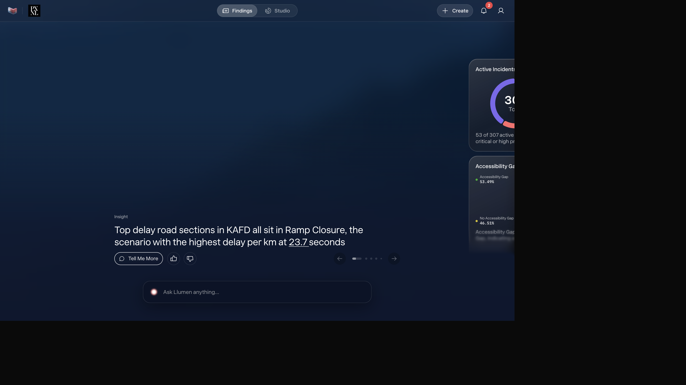 |

---

## Main status — re-tested on `main` at 768 and 390 px (2026-11-18, about 12:45)

The first four rows are the findings that had not been checked on `main`; the last two were fixed later the same day. Further fixes are listed under "Later fixes in Main" below the screenshots. "Fixed in Main" means the fix is on local `main` and can be handed to the devs as the reference.

| Finding | Was `main` affected? | Status |
|---|---|---|
| A-H2 Assets toolbar collapses at 768/390 | At 768 the toolbar was fine. At 390 Create Asset and the sort menu ran off the right edge, the grid/list toggle overlapped the Status filter, and cards were clipped. | **Fixed in Main.** On phones the search field fills the row next to Create Asset, the filters and view controls wrap onto their own rows, and the page margin drops from 40 px to 16 px. At tablet width the grid now shows two columns instead of one oversized card. |
| A-M2 Top bar / sub-nav overflow at 390 | Yes, and also at 768. The top bar stacked into three rows below 980 px. The Studio tab bar was 844 px wide with no scrolling, so Context and Settings were cut off and unreachable at both widths. | **Fixed in Main.** The top bar stays on one row down to 641 px. On phones the logo and actions share row one (Create becomes an icon button that keeps its "Create" label for screen readers) and the Briefings/Studio toggle fills row two. The tab bar scrolls sideways inside its capsule, the active tab scrolls into view when it's off-screen, and the workspace menu still opens uncut. |
| A-M3 Modal: Escape, dialog role, focus | `main` has no Edit Asset wizard (clicking a card opens nothing), so this can't be compared directly. Its Search popup already has a dialog role, moves focus into the field and closes on Escape. It did not return focus to the Search button. | **Fixed in Main** (focus return). The Edit Asset wizard itself is staging-only, so it goes to the devs. |
| A-M5 Studio state not in the URL / history | Yes, and worse: switching tabs doesn't change the URL at all (`history.length` stayed at 1), so a reload always lands on the Overview. | **Fixed in Main** (added 2026-11-22). No router was needed; see "Later fixes in Main (2026-11-22)". Search text and page number are still not kept, so those parts go to the devs as is. |
| A-M8 Table previews are hard to read; wide tables don't fit | Partly. `main` had only 4-column tables, which fit. It also had two bugs of its own: a 1 px gap above the sticky header where scrolled rows showed through, and text columns that all grew to the widest one (a "Type" column holding only "Jam" was as wide as the longest street name). | **Fixed in Main** (added 2026-11-18, about 14:25). Staging's 11 wide tables (up to 8 columns) were imported with real rows, and the table preview was redesigned; see A-M8 for the spec. |
| B Notifications: dead bell on `main`, rough outline on staging | Yes: the bell did nothing. Staging has a panel, but its 1 px near-white outline looks harsh against the dark UI. | **Fixed in Main** (added 2026-11-18, about 14:25). The bell opens a panel in the composer's glass: `rgba(14,16,20,.52)`, `blur(20px) saturate(160%)`, a 1 px `rgba(255,255,255,.12)` border, 20 px radius and the composer's shadow. Empty state "No notifications / You're all caught up." It closes on Escape (focus returns to the bell), on outside click and on resize. It is rendered outside the blurred top bar so its own blur works. The Briefings top bar's bell now opens the same panel (added 2026-11-18, about 16:20). |

| 768 px (after) | 390 px (after) |
|---|---|
|  |  |

| Tables: staging | Tables: Main (after) |
|---|---|
|  | 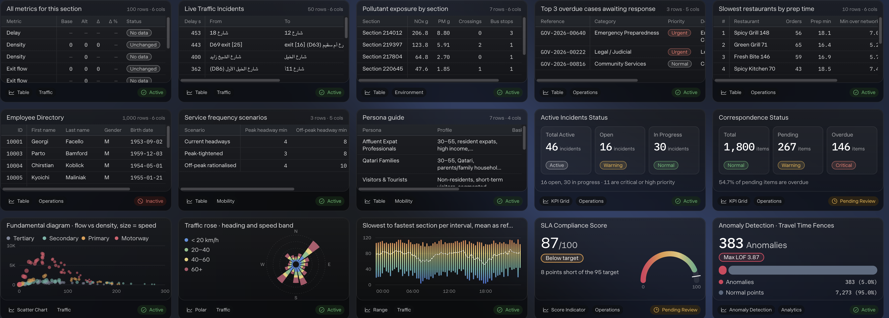 |
| | 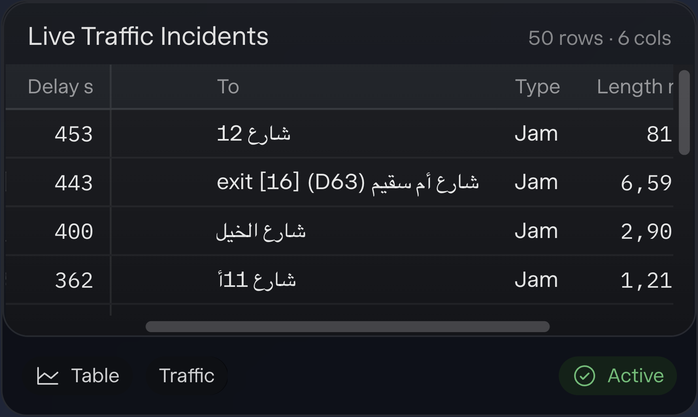 |

| Notifications: staging | Notifications: Main (after) |
|---|---|
|  | 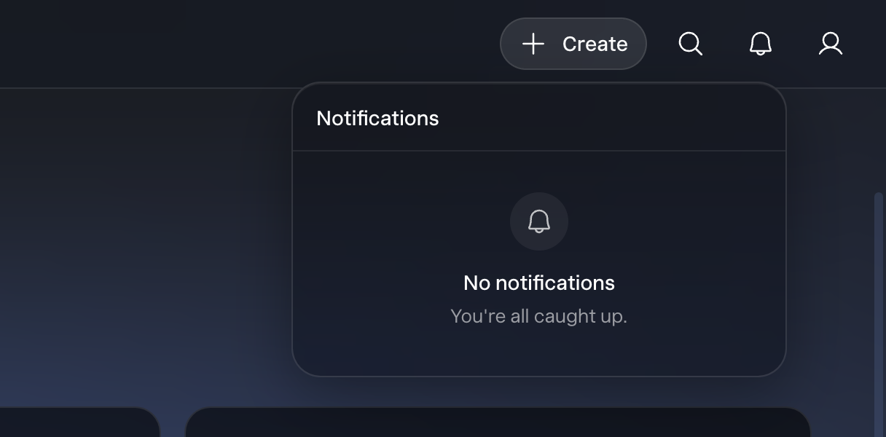 |

### Later fixes in Main (2026-11-18, about 16:20)

| Fix | What changed |
|---|---|
| Briefings at 768 px | **Fixed in Main.** The carousel dots sat on top of the vote buttons. Below 900 px the dots now flow under the votes (12 px gap) instead of being pinned to the bottom. The right-hand board cards that looked cut off are the intended 96 px peek, the same as at 1440, so they were left as they are. |
| Hidden Briefings content | **Not a bug.** It looked reachable in the accessibility snapshot, but it is already `inert`, so keyboard focus and screen readers can't reach it. |
| 4 px scrollbars | **Fixed in Main.** Chromium ignores `::-webkit-scrollbar` sizing whenever `scrollbar-color` is set, even when it's inherited, so Studio's page, the Briefings board and every auto-hiding scroller fell back to an 11 px bar. Each one now resets `scrollbar-color`/`scrollbar-width` inside `@supports selector(::-webkit-scrollbar)`, and all of them measure 4 px. |
| Card loading and error states | **Fixed in Main.** While a card's data loads, it shows a pulsing skeleton shaped like its content (chart, table or map). After 15 s with no data it shows "Couldn't load data / The source didn't respond" and a Retry button; Retry goes back to the skeleton and then the chart. The Assets list itself shows 8 placeholder cards while loading. To preview, open the command palette (⌘K) and pick a state from its States tab (Data · Live, Card loading, Card error, List loading); it switches without a reload. The same states can be linked as `?studioState=loading`, `?studioState=error` or `?studioState=loading-list`. |
| One focus ring | **Fixed in Main.** New tokens `--lc-focus-ring` (2 px solid `#70aeff`), `--lc-focus-offset` (2 px) and `--lc-focus-offset-inset` (−2 px) replace 35 separate outlines in Studio and Briefings, and a global fallback covers links, buttons, tabs and radios. Delete keeps its red ring. The story editor and older assistant panels were not changed. |
| An icon per asset type | **Fixed in Main.** Card and list tags used one chart icon for every type. They now use 23 type glyphs on a 16 px grid; close variants share a glyph (Gauge, Radial Gauge and Score Indicator, for example). |
| KPI grids | **Fixed in Main.** The two KPI grid cards now use the standard card layout: a headline, a status pill, a split bar and a legend. |
| Gauges | **Checked, not built yet.** Staging has 14 Gauge assets (not 19); 5 drew a dial and 9 were still loading. They are ticked radial dials (a tick ring colored green to amber to red, or plain white, with a marker tick, a large number and Low/High labels). `main` has no dial: its "Gauge" and "Radial Gauge" assets draw as bars or images. A mockup comes before any import. |

| Briefings 768 (after) | Card error state | Card loading state |
|---|---|---|
| 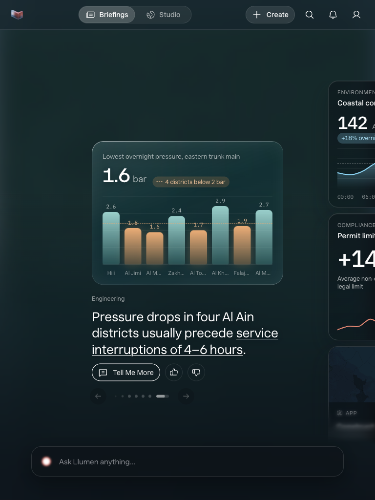 | 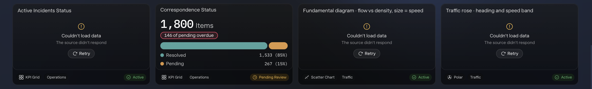 | 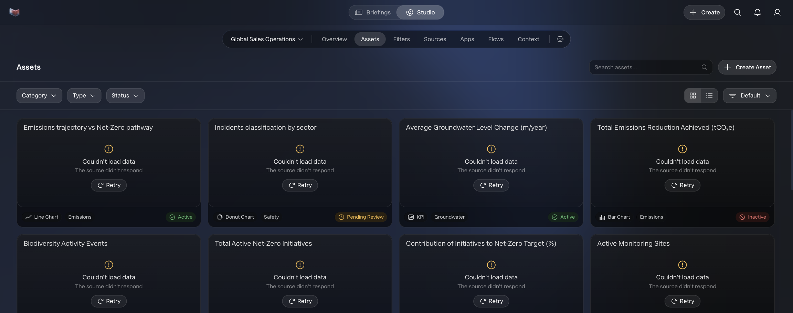 |

| Assets list loading | Staging gauges |
|---|---|
| 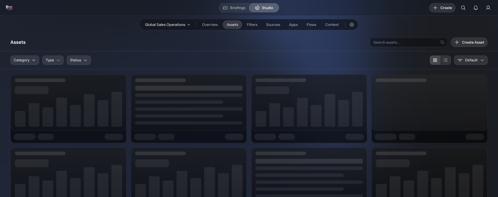 | 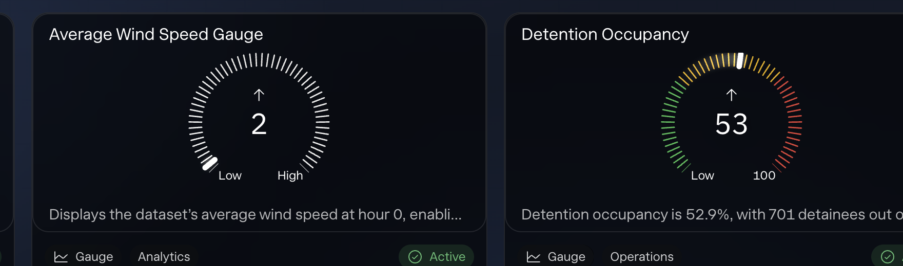 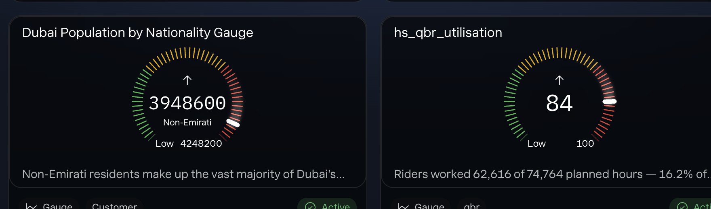 |

### Later fixes in Main (2026-11-22)

| Fix | What changed |
|---|---|
| Studio tab bar showed two surfaces below 1024 px | **Fixed in Main.** In narrow windows the tab capsule scrolls sideways, but its blur sat on a `::before` layer that only spanned the visible width (629 px of 842 px at a 663 px window). Once you scrolled, the tabs past that point (from about Apps on) sat on a second, thinner surface. In narrow windows the capsule now carries the tint and blur itself, so it reads as one surface at any scroll position. When the workspace menu is open, the blur moves back to the `::before` layer so the menu can still blur the page. |
| Table header gap came back when scrolling inside a table | **Fixed in Main.** The first fix pulled the sticky header up 1 px and shadowed it 1 px upwards. Cards are scaled, so at some table scroll positions the gap rounded to more than that pixel and a sliver of rows showed above the header again. The header now carries a 4 px strip in its own colour above it, which the table's scroller clips at rest. |
| Studio state in the URL and history (A-M5) | **Fixed in Main.** Switching to Studio adds `?view=studio`, and each Studio tab adds `&page=…` (`filters`, `apps` and so on; the default tab leaves it out). Each switch is a new history entry, so Back and Forward step through tabs (Assets, Filters, Overview, then Back twice returns to Assets) and Back from Briefings returns to the last Studio tab. A reload or a shared link opens the same tab. Going to Briefings drops `page`. Unknown values fall back to the default tab. Staging uses `?tab=` with `replaceState`, so Back leaves Studio; the devs should switch to `pushState` there. |
| Carousel rapid clicks (A-L6) | **Fixed in Main.** A click during a smooth scroll now pages on from where that scroll is headed, not from where it has got to. Three clicks 80 ms apart on "Recent assets" move exactly three pages (0 to 3015 px, the 10th card's edge); one click moves one page (1005 px). |
| List view columns (Part B "List view") | **Fixed in Main.** The list now has staging's columns: Asset, Tags, Type, Source, User Status, Agent Status, Last Updated. It keeps Main's wider name column with its description. Every header is a sort button (first click ascending, second descending, with `aria-sort` and an arrow on hover, focus or when active); picking from the Sort menu clears it. Source and Agent Status are hidden below 1280 px and Tags below 1024 px, so the name column never gets squeezed. Type and Source truncate with a `title` tooltip (A-L2). The filter bar matches: Tags, Type, Source, User Status, Agent Status. Main's mock data has no sources, so each category maps to a plausible one, and Agent Status is Active when the asset has a source and isn't Inactive. |
| Card tags collide with the status chip on narrow cards | **Fixed in Main.** At about 280 px wide (an Overview shelf card at 1280), a long type and its category ran under the status chip ("Analytics" sat behind "Active"). In `AssetCard`, the type and category tags now sit in their own strip. The strip scrolls sideways: drag it with a mouse, or use a trackpad or touch. The status chip keeps its full width. Whichever edge has more tags past it fades out over 24 px (`data-fade="start" / "end" / "both"`; nothing while everything fits), so the cut-off reads as "more this way" and never runs into the chip. Rows nest (the tag strip sits inside the draggable shelf), so a press drags the innermost row that can scroll: dragging the tags moves only the tags, and dragging the chart still moves the shelf. The strip has no scrollbar; the fade is the cue. The same strip works for any number of tags, so staging's multi-tag assets can use it as is. |
| Card design for assets with no thumbnail (design request, not a finding) | **Done in Main.** Staging shows a grey placeholder, or nothing, when an asset has no chart, table, map or image. Main now gives those cards a cover. The background is one of 16 mesh gradients made with the llumen-branding generator: the same renderer, colour blending, bokeh streaks and grain. The colours follow the brand rules: Void and Night grounds; spectrum blue and red only as light; plum and lavender tints; no greens or yellows; one to three streaks. Each of the five brand families (tide, ember, dusk, spectrum, halo) is used in turn. Every cover keeps its left side and bottom-left corner dark, and a soft Void scrim at the top and bottom keeps text readable on the brighter ones. The title sits top-left, where every other card visual puts it. Bottom-left is the asset's description (two lines at most). The cover adds no type icon or tags, because the type and category chips in the meta row below already show them. Each asset gets a fixed cover from a hash of its id, so it keeps the same one across reloads and sorts. Main has three such assets (Average bus commute time, Speed vs occupancy · Corniche, Groundwater level forecast to 2030), and the command palette's "Data · No thumbnails" state (`?studioState=no-thumbnail`) shows every card on its cover. For the devs: the stills are in `public/llumen-assets/studio/mesh/` (760 × 368, 2× the card's image area, 1.1 MB for all 16), with their palettes in `palettes.json`. `scripts/studio-mesh/generate.py [count]` regenerates them, or makes more (raise `MESH_COVERS` to match). The cover is `MeshCover` in `StudioAssetVisual.tsx`, and it's the fallback whenever an asset has nothing else to draw. |

| Studio tab bar at 663 px, scrolled (after) |
|---|
| 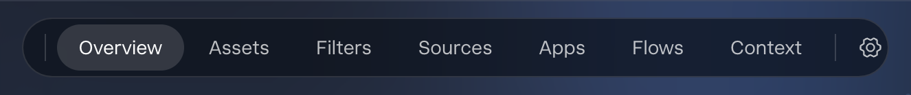 |

| Card tags at rest: fade before the status | Card tags dragged to the end |
|---|---|
| 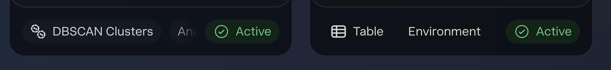 | 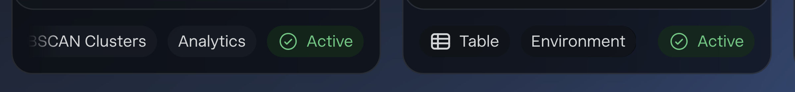 |

| Assets without a thumbnail, beside map cards (1440 px) |
|---|
| 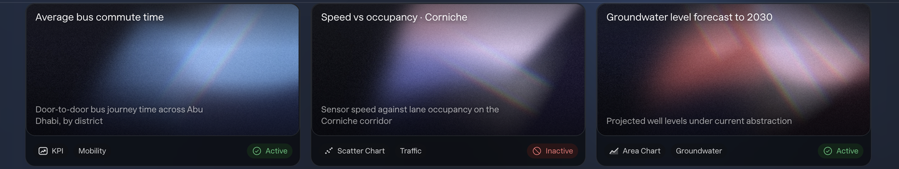 |
| "Data · No thumbnails": every card on its cover |
| 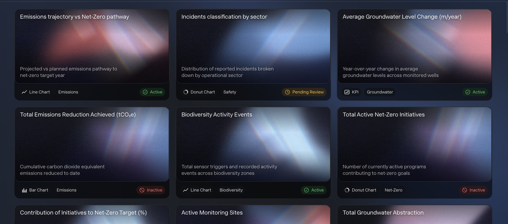 |

#### Covers for assets with no thumbnail: how to integrate

Nothing is generated while the app runs. The 16 covers are rendered once, ahead of time, and the frontend picks one per asset. The pick isn't random: the asset's id is turned into a number that chooses one of the 16. Each asset always gets the same cover, for every user and every sort order, and nothing has to be stored to remember it. `generate.py` is only for remaking or extending the set; the app never runs it.

**Implement now: a fixed set of images, chosen by asset id.** This needs no extra work beyond the frontend:

1. Copy the 16 JPGs from `public/llumen-assets/studio/mesh/` into staging's static files or CDN.
2. Copy `meshCoverFor` (about 10 lines) and `MeshCover` with its styles from `StudioAssetVisual.tsx` and `StudioAssetVisual.module.css`.
3. Show `MeshCover` wherever a card currently falls back to the grey placeholder.

There's no backend change, no database field and no new API, and nothing runs at render time. The images are cached once and shared by every card. With 16 covers two cards will sometimes match; for more variety, run `python scripts/studio-mesh/generate.py 32` (or any count) and set `MESH_COVERS` to match.

**Possible later, not needed now:**

| Option | What it gives | Why not now |
|---|---|---|
| Live WebGL meshes (`js/mesh.js` from llumen-branding) | Animated, unique per asset | Each card needs its own WebGL context, and browsers allow about 16 on a page before dropping the oldest, so a grid of 24 or more cards breaks. It also costs more GPU and battery. Suited to one large hero, not a card grid. |
| The backend renders a unique cover when an asset is created | Every asset gets a one-off cover and is served like any thumbnail, so the frontend needs no special case | Needs numpy and Pillow on the server, a step in asset creation, storage, and a backfill for existing assets. It can reuse the same colour families, so the card design wouldn't change. |

---

## Part A — Staging findings

### High

**A-H1. Failed asset data shows an endless "Loading data…" spinner with no error state**
- **Where:** Studio › Assets (grid and list thumbnails), also the Overview shelves.
- **Repro:** Open `&tab=assets`, wait 30 s or more, then scroll the grid.
- **Expected:** An error state on the card (for example "Couldn't load data" plus retry) once the request fails.
- **Actual:** 8 of 25 cards on page 1 keep the spinner forever: Abu Dhabi Citizen vs Non-Citizen, Citizens by Region, Count Distribution by Location, Current Sensor Occupancy, Flow Sum by District Entry, Gross Floor Area by Location, Incident Density, Landmarks by Category. They were still spinning more than 4 minutes later (11:42 to 11:46+).
  - The 8 card count matches the 8 asset IDs that got `400` from `/api/runner/v1/asset/data`. The page logs these as `[assetService] asset data fetch 400` warnings:
    - `43e1fafe…`: `postgres execute failed: failed to connect to user=postgres database=store: hostname resolving error …`. Retried at about 16 s and again at about 28 s.
    - `16e0fefe…`, `1fb6fa05…`, `6c004281…`, `6db3843c…`, `c25b8845…`, `c63257ba…`, `e9a61d39…`: `fusion: DoGet failed: rpc error: code = Unavailable desc = connection error …`. These fail about 20 s after the request starts.
  - Switching tabs re-fetches the same failing assets. Errors repeated at t≈565–585 s, and each fusion failure costs another 20 s.
- **Viewport:** All.
- **Evidence:**

  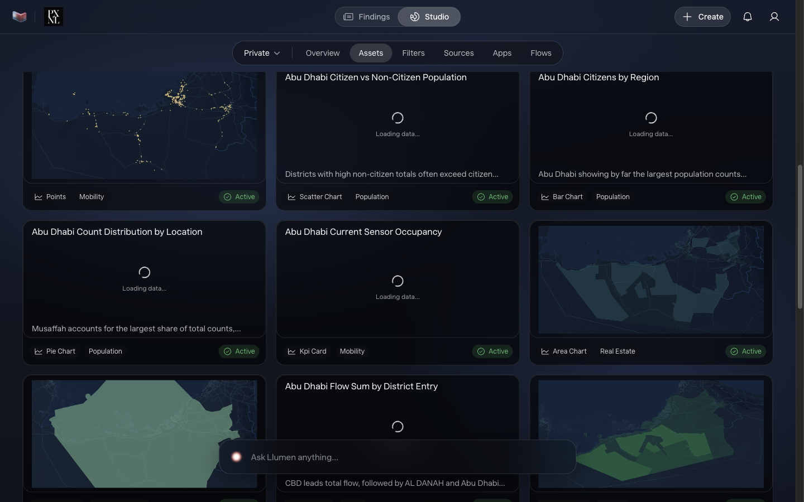
  
- **Confidence:** Real. The cause is server-side (DB DNS and fusion unavailable). The missing error presentation is a frontend bug. These assets are **broken, not slow**.

**A-H2. Assets toolbar layout collapses at tablet and mobile widths**
- **Where:** Studio › Assets header, at 768 and 390.
- **Repro:** Emulate 768×1024 and open Assets.
- **Expected:** A compact toolbar (search plus Create on one row, filters wrapping or scrolling horizontally).
- **Actual:**
  - `.KBUTKq_topRowRight` switches to `flex-direction: column`. The search container keeps `flex: 1 1 300px` / `min-width: 300px`, so in the column layout it becomes **300 px tall** (an empty search box). Measured: `height: 300px; width: 673px`.
  - Each filter chip (Tags, Type, Source, User Status, Agent Status) takes its own row. The view toggle and sort stack below them.
  - About 700 px of toolbar appears before the first card.
- **Viewport:** 768, 390. 1024 and 1280 are fine.
- **Evidence:**

  | 768 px | 390 px |
  |---|---|
  | 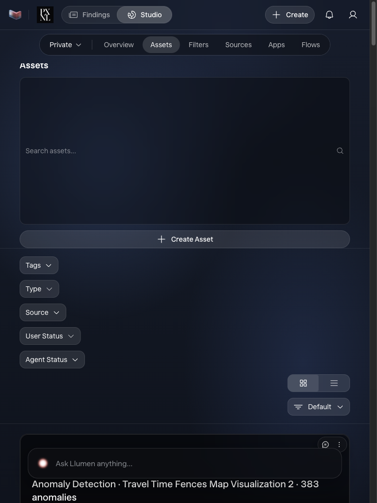 | 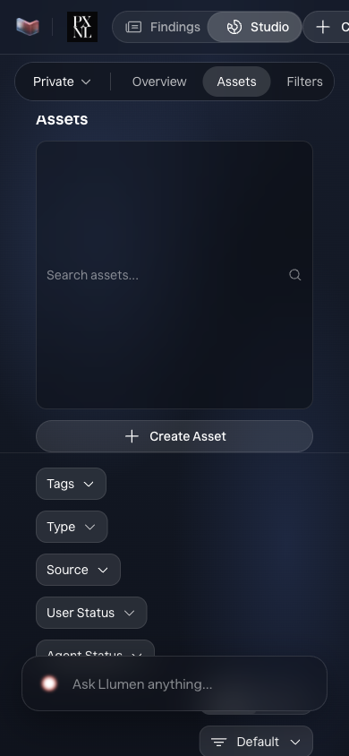 |
- **Confidence:** Real. It is High if tablet is a supported target, otherwise Medium.

### Medium

**A-M1. Empty state is shown while the list loads, and there are no skeletons**
- **Where:** Assets tab (and the Overview "Recent assets" shelf).
- **Repro:** Reload `…&tab=assets`.
- **Expected:** A skeleton grid until the first response arrives.
- **Actual:**
  - Full-screen "Loading…" (the top bar briefly disappears, so the chrome flickers), then "Loading workspace…", then **"No assets in this workspace yet" for about 200–250 ms**, then 25 cards. Measured timeline: 152 → 348 → 499 → 752 ms on one reload, 176 → 324 → 626 → 828 ms on another.
  - The Overview shows the same empty flash at about 626–777 ms.
  - The document height jumps from 900 to 3025 px when the cards arrive, which is a layout shift.
- **Viewport:** 1440.
- **Evidence:** Timing log in the session; the first frame after navigation shows the chrome-less "Loading…" (captured at 1440 during the session).
- **Confidence:** Real (loading-state design). **Not data loss**: 607 assets (25 pages of 25) load within about 1 s with a warm cache, and the list was never still empty after 20 s.

**A-M2. At 390 px the top bar overflows and actions become unreachable**
- **Where:** Global top bar and sub-nav.
- **Actual:**
  - The mode switch overlaps Create.
  - Create is clipped, and Notifications (x = 451) and Profile sit off-canvas at a 390 px viewport. There is no horizontal scroll, so they cannot be reached.
  - The sub-nav tabs scroll horizontally (`overflow-x: auto`, content 472 px in a 237 px box) with no fade or affordance. Sources, Apps and Flows are hidden.
  - The "Assets" panel label sits right under the sticky sub-nav (label top 122 px, nav bottom 113 px).
- **Evidence:** the 390 px screenshot under A-H2.
- **Confidence:** Real. It may be out of scope if mobile is unsupported.

**A-M3. Edit Asset modal: no Escape, no dialog semantics, no focus management, background still scrolls, sidebar labels clipped**
- **Where:** Assets › click a card body.
- **Actual:**
  - Escape does nothing.
  - `document.activeElement` stays on `BODY`, so focus is not moved into the modal or trapped.
  - The overlay (`position: fixed; z-index: 1400; rgba(0,0,0,.7)`) has no `role="dialog"` or `aria-modal`.
  - `body` keeps `overflow: visible`, so the page behind scrolled 400 px while the modal was open. The 15 px page scrollbar stays visible beside the overlay (overlay width 1425).
  - Sidebar labels use `text-overflow: clip`: "Mapping" (58 px of text in 51 px) runs under the green check badge, "Toolti(p)" is cut by the OFF badge, and "Map Legend" is clipped.
- **For contrast:** The Analytics result modal has `role="dialog"`, closes on Escape and sets `body { overflow: hidden }`. Neither modal moves focus into the dialog.
- **Viewport:** 1440.
- **Evidence:**

  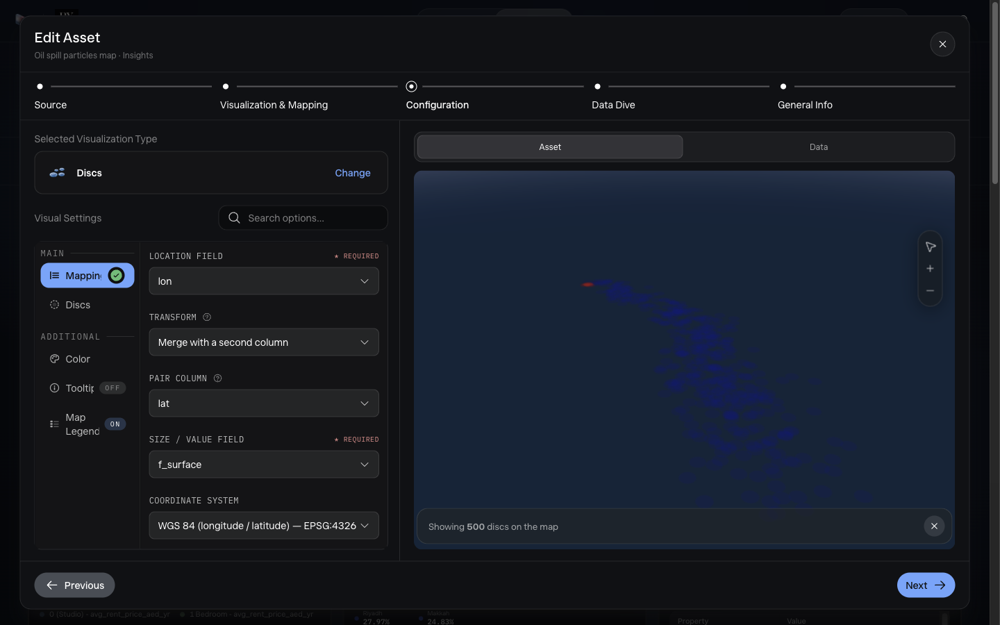
  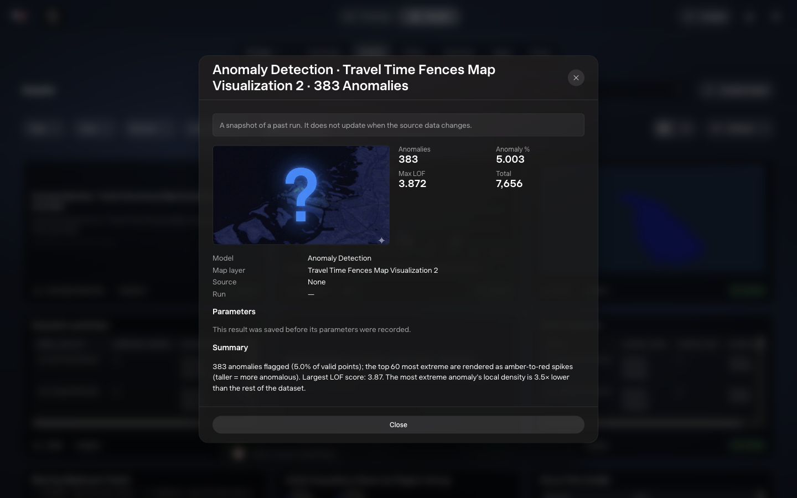
- **Confidence:** Real.

**A-M4. Map and analytics cards break the card anatomy**
- **Where:** Assets grid (and the list thumbnail column).
- **Actual:**
  - Map-type cards (Points, Discs, Area Chart; for example "Oil spill particles map", "Abu Dhabi Bus Stop Locations", "Abu Dhabi districts") show **no visible title**. Their accessible name is only "Discs Insights Active".
  - Analytics cards (Anomaly Detection, Spatial Clustering) use a different layout: small bold text, a secondary line, and a monospace uppercase slug ("ANOMALY-DETECTION", "DBSCAN-CLUSTERS") instead of a header plus chart.
- **Evidence:**

  
- **Confidence:** Real.

**A-M5. Studio state is not URL- or history-backed**
- **Actual:**
  - Sub-tab clicks update `?tab=` with `replaceState` (`history.length` stayed at 2 across Overview → Assets → Apps). Browser **Back leaves Studio entirely** instead of returning to the previous tab.
  - Search text and page number are lost on reload (typed "Abu Dhabi", went to page 2, reloaded: empty search, page 1).
  - Grid/list view persists across reloads (stored locally).
  - Changing page does not scroll to the top. After clicking "Page 2", `scrollY` stayed at 923, so the user lands at the bottom of the new page.
- **Confidence:** Real. Using `replaceState` for tabs may be deliberate, so that part needs a decision.
- **Main:** tabs are now history entries (`?view=studio&page=…` with `pushState`); see "Later fixes in Main (2026-11-22)".

**A-M6. Scrollbars break the "hug the edge, 4 px overlay" rule**
- **Actual:**
  - Studio scrolls the **document**. `html`/`body` have `scrollbar-width: auto`, so there is a classic 15 px scrollbar: body width is 1425 at a 1440 viewport. (On machines set to overlay scrollbars the bar takes no width, but it still isn't the 4 px treatment.)
  - Table previews inside asset cards (`.h-full.w-full.overflow-auto`) render classic scrollbars on **both axes** inside thumbnails ("Worst sections", "Scenario summary", "About this model").
  - The filter dropdown scroller (`.llumen-dropdown-scroll`) sits inside a menu with `padding: 4px`, so the thumb is inset 4 px from the edge and is 11 px wide (`scrollbar-width: thin`) instead of 4 px.
- **Evidence:**

  
  
- **Confidence:** Real. The table-preview part is fixed in Main (see A-M8).

**A-M8. Table previews are hard to read, and wide tables don't fit the card**
- **Where:** Table-type asset cards (Assets grid and Overview shelves). Staging has 91 table assets; 21 in the private workspace, many with 5–8 columns.
- **Actual:**
  - Headers are raw column names (`delay_s_per_km`, `co2_g_per_vehicle`, `configured_speed_kmh`).
  - Figures are unrounded and left-aligned (`264.98900865426316`), so columns don't line up.
  - Text cells wrap into tall rows ("Dynamic / Scenario - / Ramp Closure"), so only 2 rows fit in the card.
  - Classic scrollbars on both axes, inset from the card edge (see A-M6).
  - Status values show as raw codes (`no_data`, `alternative_only`).
- **Fixed in Main — spec for the devs:**
  - Headers in plain words with units: `co2_g_per_vehicle` → "CO₂ g/veh".
  - Every column sizes to its own content (CSS grid `auto` / `max-content` tracks; not `1fr`, which makes every column as wide as the widest).
  - Numbers: right-aligned, mono with tabular figures, never wrapped.
  - Text: wraps at about 148 px, two lines at most, then "…"; the full value is the tooltip. Codes and dates don't wrap.
  - Status columns (Status, Priority, Magnitude) as tone chips: red for Worse / Major / Urgent, amber for Moderate, green for Recommended / Better, neutral for the rest. Codes are humanised ("No data", "Alternative only").
  - Empty values ("—") are faded.
  - Right-to-left text (Arabic street names) keeps its own word order but aligns with its column.
  - If the columns don't fit, the table scrolls sideways as well as down, with 4 px overlay thumbs on the card edge. At 5 or more columns the first column stays in place.
  - The sticky header sits 1 px higher with a 1 px shadow in its own colour, so no row text shows above it.
  - The header shows the source's full count ("1,000 rows · 6 cols") even when the card carries only the first rows.
- **Evidence:** the "Tables" pair under Main status above.
- **Confidence:** Real.

**A-M7. Accessibility gaps in menus and controls**
- **Actual:**
  - The Type filter menu has 37 `role="menuitemcheckbox"` items with **no accessible name**.
  - List-view "More options" buttons are unnamed (25 per page).
  - Create, filter and view-toggle buttons expose no `aria-expanded` or `aria-pressed`.
  - After Escape closes a filter menu, focus is lost instead of returning to the trigger.
  - The view toggle's DOM order (List, Card) is the reverse of its visual order (Card, List), so the tab order does not match what is on screen.
  - (Found 2026-11-22.) The Notifications bell is a `<button>` nested inside a `
`: two Tab stops for one control, and the outer one is announced as "2" (the unread badge).
- **Focus-visible (forced) is inconsistent:**
  - Create and sub-nav tabs: `2px solid #60a5fa`, offset 2 px.
  - Filter buttons: no change (only the resting `1px rgba(255,255,255,.1)` outline remains).
  - Pagination: browser default `auto 1px rgb(153,200,255)`.
- **Confidence:** Real. Native Tab traversal could not be exercised (see "Not tested").

### Low

**A-L1. Card "More options" menu and menu surfaces are inconsistent**
- "Delete Asset" uses the same 80 % white as the other items, with no destructive color and no separator before Archive/Delete.
- Staging uses two menu surfaces:
  - Filter dropdowns: `rgba(66,66,66,.5)`, 8 px item radius, 100 % white text.
  - Card and Create menus: Tailwind `zinc-600/80` (oklab 0.44, alpha 0.8), 12 px item radius, 80 % text.
- **Evidence:**

  

**A-L2. Truncated list cells have no tooltip in two columns.** Asset names truncate with a `title` tooltip. The Type and Source cells truncate with no tooltip, for example "Anomaly Detec…", `DM_area_performance_lumen`, `Saudi_Police_Llumen_Demo_Lumin_Tables_MOI`. The name column is only about 153 px wide at 1440, so most names truncate. Main's list now has these columns, with tooltips on Type and Source.

  

**A-L3. Every type chip uses the same chart icon.** All asset types (Bar, Table, Points, Discs, KPI, Pie, Scatter, Analytics…) use the same SVG path `M232,208…`. Main used to do the same; it now has a glyph per type (see "An icon per asset type" under Later fixes).

**A-L4. Analytics result modal polish**
- The thumbnail is a placeholder (large "?" from `/images/thumbnails/placeholder.png`).
- ~~The title casing differs from the card ("383 Anomalies" vs "383 anomalies").~~ Fixed on staging by 2026-11-22.
- There are two close controls (X and a full-width Close), and the X has no accessible name.
- `/api/storage/asset-thumbnail/:id/url` returns some 404s, which is why placeholders appear.
- **Evidence:** the Analytics modal screenshot under A-M3.

**A-L5. Off-palette blue accent (speculative).** The active pagination page uses a bright blue fill, and so do the Edit wizard's Next button and its active step and sidebar item. Nothing else in Studio uses this accent; the rest is white or neutral. Needs a decision. Evidence: the pagination screenshot under A-H1 and the wizard under A-M3.

**A-L6. Carousel rapid clicks advance unevenly.** Clicking Next again within about 700 ms (mid smooth-scroll) advances only a few pixels or none. At normal speed (about 1.6 s apart) the steps are about 997 px and the disabled states are correct at both ends. Main behaved the same way; it is fixed there now (each click moves a full page).

**A-L7. Findings hero has no visual (speculative).** After 5 s the Findings hero area showed no map or visual behind the insight text (plain navy). Main shows a 3D map. It may be data- or slow-load-related.

  | Staging Findings (after 5 s) | Main Briefings |
  |---|---|
  | 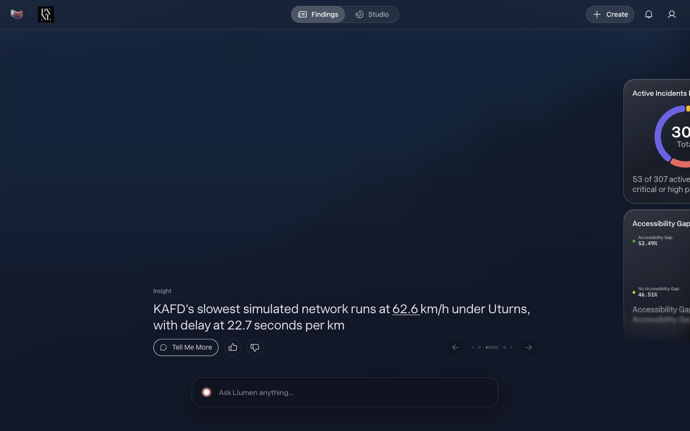 |  |

**A-L8. Console and network notes**
- The only other console warning was from deck.gl: "The `light` root property is deprecated, prefer using `lights`…".
- No uncaught errors or unhandled rejections were captured.
- The Resource Timing buffer hit its 250-entry limit, so the slow-request picture is partial. The requests that were recorded were fast: assets/content max 217 ms, runner `asset/data` max 275 ms. The slow ones are the about-20 s fusion failures, which surface as `400`.

**A-L9. Assets grid cards lack Monitor.** On 2026-11-18 no card offered "Monitor". By 2026-11-22 the Overview's asset cards have it on most cards ("Monitor Incident Map" and so on), but the Assets grid still shows only "Add to chat" and "More options"; see Part B.

---

## Part B — Staging vs main design inconsistencies (1440×900)

Mock-data differences are ignored. "Source of truth" is my recommendation.

| Area | Staging | Main | Evidence | Confidence | Suggested source of truth |
|---|---|---|---|---|---|
| Mode switch labels | "Findings / Studio" (226 px, `position:absolute`) | "Briefings / Studio" (232 px) | `staging-overview-1440.png`, `main-overview-1440.png` | Real | Needs decision (naming) |
| Top bar left | Llumen logo + divider + org badge image ("PNVL") | Logo only | same | Real | Staging (real tenant branding) |
| Top bar right | Create · Notifications · Profile ("User Profile") | Create · **Search** · Notifications · Account | same | Real | Main for Search (missing on staging); needs decision |
| Studio sub-nav | "Private ▾" picker + 6 tabs as `role=tab`; nav 593 px | Workspace name pill "Global Sales Operations ▾" + 6 tabs as buttons with `aria-current` + **Settings gear**; nav 758 px. Pill tokens are identical (34 px, 999 px radius, 14 px, active `rgba(255,255,255,.14)`) | same | Real | Main for Settings; staging's `tablist` semantics are better |
| Quick actions | "Create Asset" (Title Case); App copy "Pages of maps and cards" → card height 104 | "Create asset" (sentence case); App copy "A dashboard, slide deck or command room" → 122 (wraps to 3 lines). Same tokens: 18 px radius, `rgba(0,0,0,.56)`, 20 px padding, title 16/600 | same | Real | Main casing (sentence case matches the rest of main) |
| Page scroll container | Document scroll; classic 15 px scrollbar where the OS shows classic scrollbars (`scrollbar-width:auto`) | `<main>` scroller, `scrollbar-width:thin` (11 px), `rgba(132,177,245,.14)` thumb, no padding | same | Real | Main (now 4 px `--lc-scrollbar-size`; it was 11 px until the 2026-11-18 fix) |
| Asset card shell | 16 px radius, 1 px `rgba(255,255,255,.1)` border (`.22` on hover), `rgba(0,0,0,.56)`; `transition: border-color .2s`; card cursor default (overlay button gives pointer) | Same tokens; `transition: border-color .2s, transform .2s` (hover lift); `cursor:pointer` on the card | forced-hover comparison | Real | Main (adds hover motion) |
| Card hover actions | Overview: Add to chat + Monitor (most cards, since 2026-11-22) + "Asset actions". Grid: Add to chat + More options | Add to chat + **Monitor** + More options (3) everywhere | forced hover; snapshots | Real | Main (Monitor still missing from staging's Assets grid) |
| Card title | HTML `h3` 18 px / 400, line-height 24 | Chart-SVG text 14 px / 400 | computed styles | Real | Needs decision (main is denser and matches the 14 px chip/body scale) |
| Type chip | 12 px, `rgba(48,55,64,.2)`, 999 px radius, 4/8 padding, truncates with ellipsis; label "Kpi Card" | Same tokens, no truncation; label "KPI" | computed styles | Real | Main label casing ("KPI") |
| Status pill | Green "Active" only in cards (agent status shown only in list) | Active / Pending Review (amber) / Inactive (red) in cards | `main-assets-grid-1440.png` | Partly test data | Main (multi-state pill in cards) |
| Card actions on map and analytics assets | No title; analytics cards use a custom text layout | Every card has a title plus chart | A-M4 | Real | Main |
| Assets page header | "Assets" is a `span.panelLabel` (18/600) | `h2` (18/600) | computed styles | Real | Main (semantic heading) |
| Filters bar | Tags · Type · Source · User Status · Agent Status. Button 36 px, 12 px radius, `border:0` + `outline:1px rgba(255,255,255,.1)`, font set on the button 16 px (label 14 px) | Category · Type · Status. Button 36 px, 12 px radius, `border:1px rgba(255,255,255,.1)`, 14/20 | `staging-assets-grid-top-1440.png`, `main-assets-grid-1440.png` | Real (looks nearly identical) | Staging for filter set (real backend); main for implementation |
| Search field | Outline-based border; textbox named by placeholder | 1 px border; `role=searchbox`, label "Search assets" | computed styles | Real | Main |
| View toggle | `List view` / `Card view` buttons, DOM order reversed from visual order, no `aria-pressed` | `radiogroup` Grid / List in visual order | computed styles; snapshot | Real | Main |
| Filter dropdown | Same surface `rgba(66,66,66,.5)`, 12 px radius, 4 px padding, 36 px rows; items unnamed; 37 types and no search | Same surface; `listbox`/`option` with names; `aria-expanded` on the trigger | `staging-type-filter-open-1440.png`, `main-type-filter-open-1440.png` | Real | Main semantics; consider search for long lists |
| Card "More options" menu | 6 items (Edit Asset, Reanalyze, Regenerate Thumbnail, Duplicate, Archive, Delete), zinc-600/80, item radius 12, 80 % text, Delete not red | 3 items (Duplicate, Deactivate, Delete), `rgba(66,66,66,.5)`, item radius 8, Delete `rgb(241,116,116)` | `staging-card-more-options-menu-1440.png`, `main-card-more-options-menu-1440.png` | Real | Main visuals + staging item set |
| Create menu | 120 px wide, zinc-600/80, 12 px radius, light shadow; items Asset / App / **Flow** (all enabled), weight 400, 80 % text | 200 px wide, `rgba(10,16,28,.94)`, 14 px radius, `0 16px 40px rgba(0,0,0,.4)`; items Asset / App "Soon" / **Agent** "Soon", weight 500 | `staging-create-menu-1440.png`, `main-create-menu-1440.png` | Real | Main visuals; item labels need decision (Flow vs Agent) |
| List view | Columns Asset · Tags · Type · Source · User Status · Agent Status · Last Updated (sortable header buttons); row actions Add to chat + unnamed More; name column about 153 px (truncates) | Columns Asset · Category · Type · Status · Last Updated; More only; wide name + description | `staging-assets-list-1440.png`, `main-assets-list-1440.png` | Real | Main (since 2026-11-22: staging's columns and sortable headers, main's wide name column) |
| Pagination | Items-per-page + "1–25 of 607" + numbered pager with blue active page | None (14 mock items) | `staging-assets-pagination-1440.png` | Real | Staging (missing on main; define its style in main) |
| Notifications | Popover empty state "No notifications / You're all caught up!" (Escape closes) | Bell was a dead click (no panel). **Now fixed in Main** with a glass panel (see Main status) | `staging-notifications-1440.png`, `main-notifications-click-1440.png`, `main-fixed-notifications-1440.png` | Real | Main (staging's behaviour, in the composer's glass instead of the near-white outline) |
| Page background | Static gradients: a `backdrop` layer of stacked `radial-gradient`s (blue glows at 28% 32% and 82% 72%, plus one near the top) over dark navy, with no animation and no shader canvas. The senior engineer agreed to switch it to the shader; **re-checked 2026-11-22 (about 14:20): not done yet** on Studio or Findings (the only canvas on Findings is the Mapbox map) | Animated shader background, "Mesh" by default (slow charcoal-to-blue); the others (Moving glow and five Diffraction looks) can be picked from the command palette's Shaders tab | `staging-background-studio-2026-11-22.png`, `main-overview-1440.png`, DOM check | Real | Main (shader background) |
| Escape and focus return on menus | Focus is lost after Escape | Focus returns to the trigger | eval | Real | Main |
| Focus-visible rings | Top bar and tabs `2px solid #60a5fa` offset 2; filters none; pager UA default | Top bar and tabs UA default `auto 1px`; filters `2px solid rgb(112,174,255)` offset 2 | forced `:focus-visible` | Real | Main (since 2026-11-18 one token everywhere: `--lc-focus-ring`, 2 px solid `#70aeff`) |
| Composer | 640 px, 20 px radius, `rgba(14,16,20,.52)`, `blur(20px) saturate(1.6)`, same shadow; editor padding 7/0; Add context only | Identical box; editor padding 7/0/7/4; **Attach file** (disabled) + Add context | computed styles | Real | Main (adds Attach); otherwise matching |
| Font stacks | Three stacks mixed: `"Innovator Grotesk", innovatorGrotesk, …Fallback` / `"Innovator Grotesk", Inter, sans-serif` / `"Innovator Grotesk", sans-serif` | One stack: `"Innovator Grotesk", system-ui, …` | computed styles | Real (invisible while the web font loads correctly) | Main |
| Body background | `rgb(10,10,10)` | `rgb(5,6,10)` | computed styles | Real (mostly covered by the gradient) | Needs decision |
| Findings / Briefings hero | Plain navy behind the insight | 3D map behind the insight | `staging-findings-after-5s-1440.png`, `main-briefings-1440.png` | Speculative (possibly data or slow) | Main |
| 1024 px behaviour | 2-column shelf grid, arrows `display:none`, quick actions 3 + 2 | Same (arrows not rendered) | `staging-overview-1024.png` | Consistent | — |
| Hidden content in the a11y tree (main only) | — | While Studio is shown, the Briefings view (findings carousel, My Board dialog) stays in the accessibility tree | main snapshot | Not a bug (the view is `inert`, so focus and screen readers skip it) | Either |

### Side-by-side screenshots

| Staging | Main |
|---|---|
| **Overview** | |
|  |  |
| **Assets grid** | |
|  |  |
| **Assets list** | |
|  | 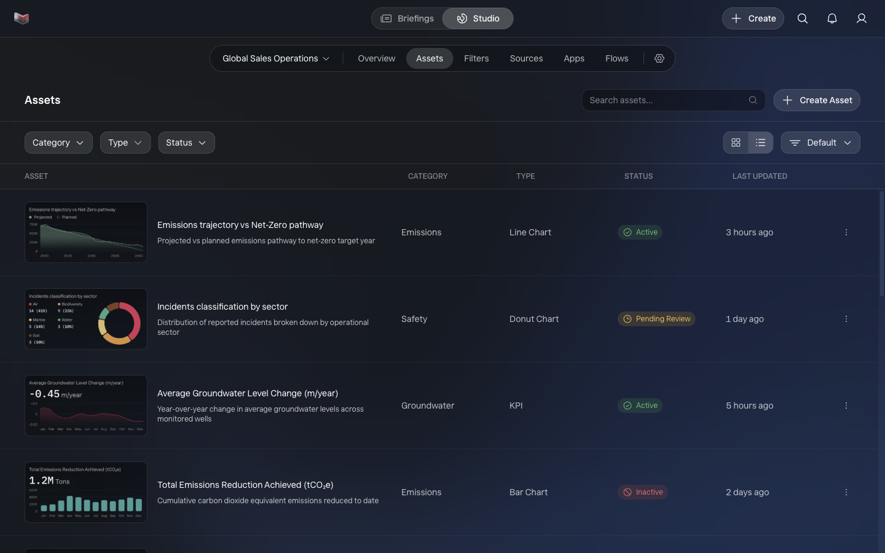 |
| **Type filter open** | |
|  | 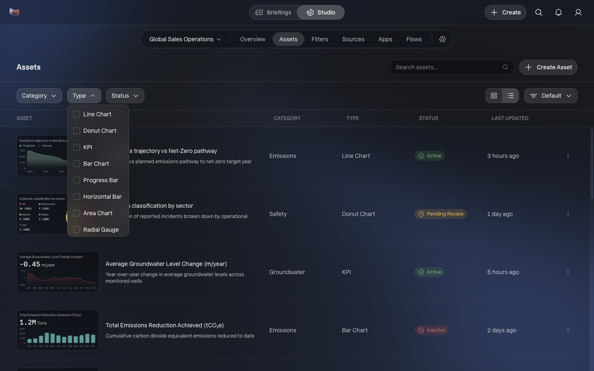 |
| **Card "More options" menu** | |
|  |  |
| **Create menu** | |
|  |  |
| **Notifications** | |
|  |  |
| **Findings / Briefings** | |
| 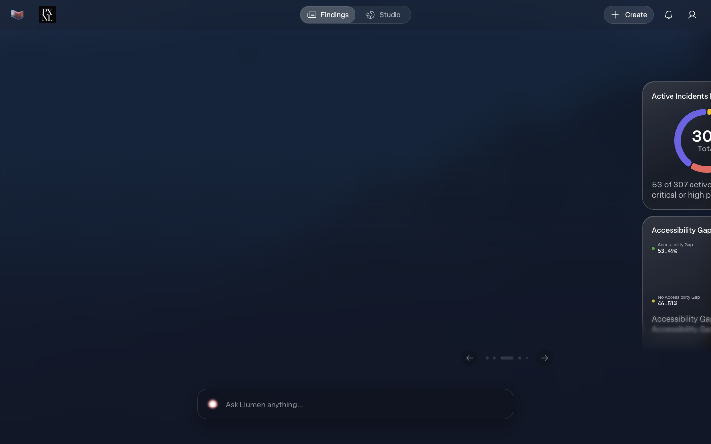 |  |

**Staging only**

| Overview at 1024 px | Assets bottom at 1024 px |
|---|---|
| 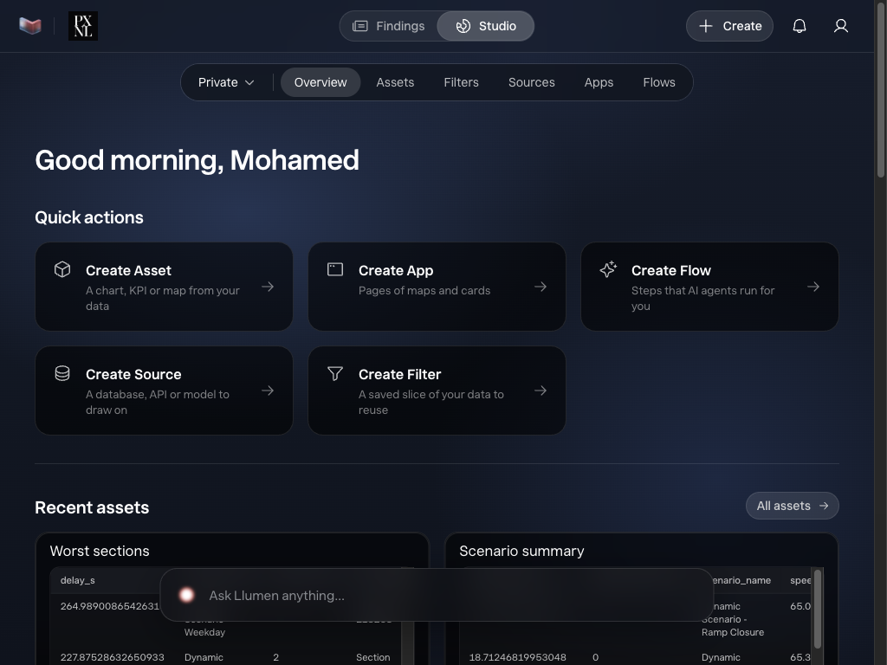 | 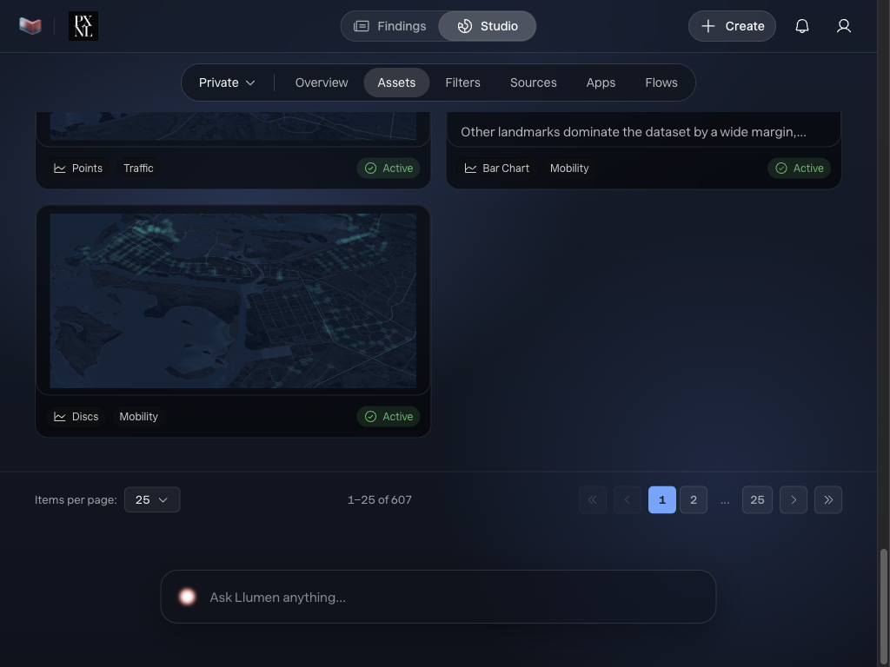 |

---

## Not tested

- Real keyboard Tab traversal. The key tool sends synthetic DOM key events, so focus doesn't move natively. Focus rings were checked by forcing `:focus-visible` instead.
- Map pan and zoom inside map cards and in the wizard preview.
- On staging: items-per-page change, sort options, selecting filter values, and list column-header sorting. (Main's column sorting was tested on 2026-11-22.)
- Filters, Sources, Apps and Flows tabs; Profile menu; workspace picker. Only Assets and Overview were audited in depth on either side.
- Add to chat / Monitor actions and composer submit (these would create data).
- Double-click behaviour.
- Network response bodies and CDP `Log` events. Console output was captured through an in-page wrapper only.
- Staging at 1280 was only checked for layout metrics (nothing broken).
- Browsers other than Chromium. The scrollbar fixes target a Chromium quirk; Safari and Firefox were not opened.
- Real touch devices. Touch was emulated only, so sideways scrolling of the tab bar, shelves and card tags hasn't been tried with a finger.
- `prefers-reduced-motion`, colour contrast (for example, muted text and the faint neutral tag pill on dark cards) and zoom at 200%.
- Staging's console and network notes (A-L8) were not re-checked on 2026-11-22; every other staging finding was.
