# Studio QA + design audit — staging vs `main`

- **Date:** 2026-11-18, about 11:35–11:57 (UTC+2)
- **Staging:** `https://staging.llumen.io/studio?workspace=59f25e0c-…&workspaceType=private` (tab `0e2093`)
- **Main:** `http://localhost:5173/llumen-frontend/?studio=10` (tab `353cf4`; mock data)
- **Method:** Read-only. Emulation at 1440×900, 1280, 1024, 768 and 390. Computed styles read with `getComputedStyle`. Hover and focus states were forced with CDP `CSS.forcePseudoState`. Console output was captured by an in-page `console.warn`/`console.error` wrapper injected before load. Timing comes from a 50 ms DOM poller injected before load. Nothing was created, saved or edited. The Edit Asset wizard was opened once by accident (a coordinate click) and closed with its X.
- **Evidence:** screenshots are embedded inline. Open this file in Markdown preview (Cmd+Shift+V) to see them.
- **Scope note:** The parent agent added new Studio assets to local `main` by hot reload (tables, KPI grids, scatter, polar, range, score, analytics, map assets). Those are in-progress work and are **not** reported as staging/main inconsistencies. The `main` evidence in this report was captured before or apart from those additions, and the Part B rows compare shared design tokens and behaviour, not asset catalogue content.

## Summary

- **The "assets disappear / No assets in this workspace yet" claim is not data loss.** On reload of `&tab=assets` the order is: full-screen "Loading…" at about 150 ms (the top bar disappears), then "Loading workspace…" at about 330 ms, then the **empty state "No assets in this workspace yet" for about 200–250 ms** (from about 500–630 ms), then 25 cards "1–25 of 607" at about 750–830 ms. This repeated on 3 reloads. No skeleton elements exist. It is a loading-state bug (Medium), not High.
- **The biggest real bug is that failed assets spin forever.** Every card whose data request returns HTTP 400 shows "Loading data…" indefinitely. On page 1 that is 8 of 25 cards, still spinning after more than 4 minutes. The errors were 1 postgres DNS failure and 7 `fusion: DoGet failed … Unavailable`, each taking about 20 s to fail. The failing assets are re-fetched on every tab switch.
- **Responsive layout breaks at ≤768 px.** The Assets toolbar search box grows to 300 px tall and the filters stack one per row. At 390 px the top bar pushes Notifications and Profile off-screen.
- **Modal consistency is weak.** The Edit Asset modal has no Escape handling, no dialog role and no focus management, and the page behind it still scrolls. The Analytics modal does all of these correctly.
- **Staging and `main` share the same tokens for cards, chips, composer, sub-nav pills and filter dropdowns** (values match to the pixel). The differences are in nav labels and extra controls, the scroll container and scrollbar, card title size, card hover actions, the Create and card menus, list-view columns, focus rings, and features missing on one side (pagination and notifications are missing on main; Search, Settings and Monitor are missing on staging).

---

## Main status — re-tested on `main` at 768 and 390 px (2026-11-18, about 12:45)

The four findings above that had not been checked on `main`. "Fixed in Main" means the fix is on local `main` and can be handed to the devs as the reference.

| Finding | Was `main` affected? | Status |
|---|---|---|
| A-H2 Assets toolbar collapses at 768/390 | At 768 the toolbar was fine. At 390 Create Asset and the sort menu ran off the right edge, the grid/list toggle overlapped the Status filter, and cards were clipped. | **Fixed in Main.** On phones the search field fills the row next to Create Asset, the filters and view controls wrap onto their own rows, and the page margin drops from 40 px to 16 px. At tablet width the grid now shows two columns instead of one oversized card. |
| A-M2 Top bar / sub-nav overflow at 390 | Yes, and also at 768. The top bar stacked into three rows below 980 px. The Studio tab bar was 844 px wide with no scrolling, so Context and Settings were cut off and unreachable at both widths. | **Fixed in Main.** The top bar stays on one row down to 641 px. On phones the logo and actions share row one (Create becomes an icon button that keeps its "Create" label for screen readers) and the Briefings/Studio toggle fills row two. The tab bar scrolls sideways inside its capsule, the active tab scrolls into view when it's off-screen, and the workspace menu still opens uncut. |
| A-M3 Modal: Escape, dialog role, focus | `main` has no Edit Asset wizard (clicking a card opens nothing), so this can't be compared directly. Its Search popup already has a dialog role, moves focus into the field and closes on Escape. It did not return focus to the Search button. | **Fixed in Main** (focus return). The Edit Asset wizard itself is staging-only, so it goes to the devs. |
| A-M5 Studio state not in the URL / history | Yes, and worse: switching tabs doesn't change the URL at all (`history.length` stayed at 1), so a reload always lands on the Overview. | **Not fixed.** `main` has no router; this needs a decision on whether the prototype should have one. Send to the devs as is. |

| 768 px (after) | 390 px (after) |
|---|---|
| 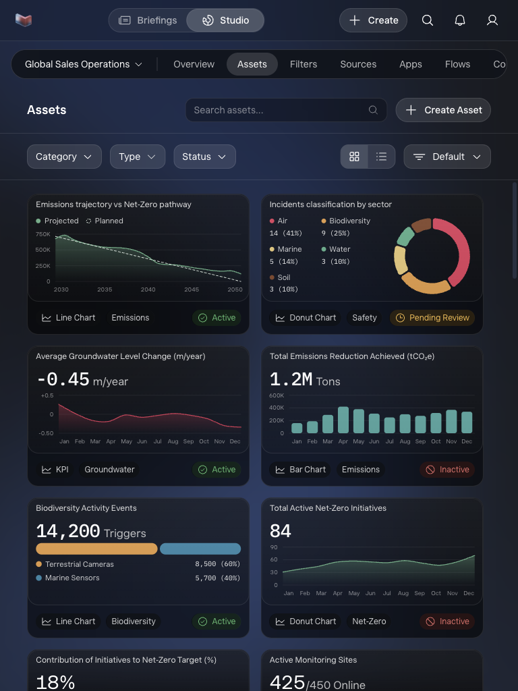 | 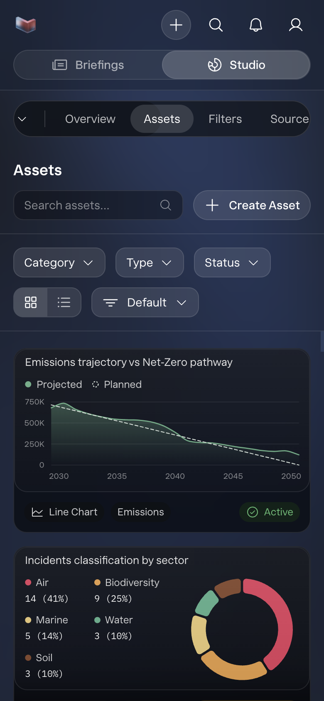 |

**New, found while testing (main only, not fixed):** on Briefings at 768 px the View button overlaps the carousel dots and the right-hand cards are cut off at the window edge.

---

## Part A — Staging findings

### High

**A-H1. Failed asset data shows an endless "Loading data…" spinner with no error state**
- **Where:** Studio › Assets (grid and list thumbnails), also the Overview shelves.
- **Repro:** Open `&tab=assets`, wait 30 s or more, then scroll the grid.
- **Expected:** An error state on the card (for example "Couldn't load data" plus retry) once the request fails.
- **Actual:** 8 of 25 cards on page 1 keep the spinner forever: Abu Dhabi Citizen vs Non-Citizen, Citizens by Region, Count Distribution by Location, Current Sensor Occupancy, Flow Sum by District Entry, Gross Floor Area by Location, Incident Density, Landmarks by Category. They were still spinning more than 4 minutes later (11:42 to 11:46+).
  - The 8 card count matches the 8 asset IDs that got `400` from `/api/runner/v1/asset/data`. The page logs these as `[assetService] asset data fetch 400` warnings:
    - `43e1fafe…`: `postgres execute failed: failed to connect to user=postgres database=store: hostname resolving error …`. Retried at about 16 s and again at about 28 s.
    - `16e0fefe…`, `1fb6fa05…`, `6c004281…`, `6db3843c…`, `c25b8845…`, `c63257ba…`, `e9a61d39…`: `fusion: DoGet failed: rpc error: code = Unavailable desc = connection error …`. These fail about 20 s after the request starts.
  - Switching tabs re-fetches the same failing assets. Errors repeated at t≈565–585 s, and each fusion failure costs another 20 s.
- **Viewport:** All.
- **Evidence:**

  
  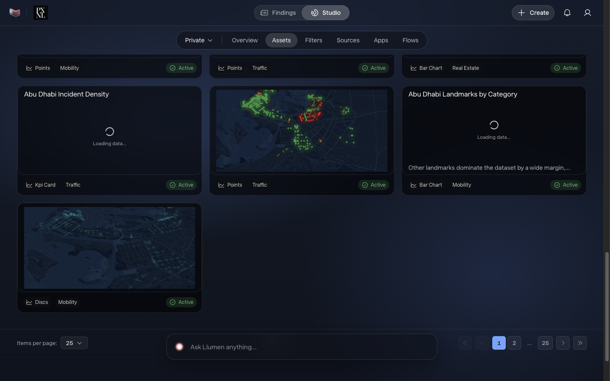
- **Confidence:** Real. The cause is server-side (DB DNS and fusion unavailable). The missing error presentation is a frontend bug. These assets are **broken, not slow**.

**A-H2. Assets toolbar layout collapses at tablet and mobile widths**
- **Where:** Studio › Assets header, at 768 and 390.
- **Repro:** Emulate 768×1024 and open Assets.
- **Expected:** A compact toolbar (search plus Create on one row, filters wrapping or scrolling horizontally).
- **Actual:**
  - `.KBUTKq_topRowRight` switches to `flex-direction: column`. The search container keeps `flex: 1 1 300px` / `min-width: 300px`, so in the column layout it becomes **300 px tall** (an empty search box). Measured: `height: 300px; width: 673px`.
  - Each filter chip (Tags, Type, Source, User Status, Agent Status) takes its own row. The view toggle and sort stack below them.
  - About 700 px of toolbar appears before the first card.
- **Viewport:** 768, 390. 1024 and 1280 are fine.
- **Evidence:**

  | 768 px | 390 px |
  |---|---|
  |  |  |
- **Confidence:** Real. It is High if tablet is a supported target, otherwise Medium.

### Medium

**A-M1. Empty state is shown while the list loads, and there are no skeletons**
- **Where:** Assets tab (and the Overview "Recent assets" shelf).
- **Repro:** Reload `…&tab=assets`.
- **Expected:** A skeleton grid until the first response arrives.
- **Actual:**
  - Full-screen "Loading…" (the top bar briefly disappears, so the chrome flickers), then "Loading workspace…", then **"No assets in this workspace yet" for about 200–250 ms**, then 25 cards. Measured timeline: 152 → 348 → 499 → 752 ms on one reload, 176 → 324 → 626 → 828 ms on another.
  - The Overview shows the same empty flash at about 626–777 ms.
  - The document height jumps from 900 to 3025 px when the cards arrive, which is a layout shift.
- **Viewport:** 1440.
- **Evidence:** Timing log in the session; the first frame after navigation shows the chrome-less "Loading…" (captured at 1440 during the session).
- **Confidence:** Real (loading-state design). **Not data loss**: 607 assets (25 pages of 25) load within about 1 s with a warm cache, and the list was never still empty after 20 s.

**A-M2. At 390 px the top bar overflows and actions become unreachable**
- **Where:** Global top bar and sub-nav.
- **Actual:**
  - The mode switch overlaps Create.
  - Create is clipped, and Notifications (x = 451) and Profile sit off-canvas at a 390 px viewport. There is no horizontal scroll, so they cannot be reached.
  - The sub-nav tabs scroll horizontally (`overflow-x: auto`, content 472 px in a 237 px box) with no fade or affordance. Sources, Apps and Flows are hidden.
  - The "Assets" panel label sits right under the sticky sub-nav (label top 122 px, nav bottom 113 px).
- **Evidence:** the 390 px screenshot under A-H2.
- **Confidence:** Real. It may be out of scope if mobile is unsupported.

**A-M3. Edit Asset modal: no Escape, no dialog semantics, no focus management, background still scrolls, sidebar labels clipped**
- **Where:** Assets › click a card body.
- **Actual:**
  - Escape does nothing.
  - `document.activeElement` stays on `BODY`, so focus is not moved into the modal or trapped.
  - The overlay (`position: fixed; z-index: 1400; rgba(0,0,0,.7)`) has no `role="dialog"` or `aria-modal`.
  - `body` keeps `overflow: visible`, so the page behind scrolled 400 px while the modal was open. The 15 px page scrollbar stays visible beside the overlay (overlay width 1425).
  - Sidebar labels use `text-overflow: clip`: "Mapping" (58 px of text in 51 px) runs under the green check badge, "Toolti(p)" is cut by the OFF badge, and "Map Legend" is clipped.
- **For contrast:** The Analytics result modal has `role="dialog"`, closes on Escape and sets `body { overflow: hidden }`. Neither modal moves focus into the dialog.
- **Viewport:** 1440.
- **Evidence:**

  
  
- **Confidence:** Real.

**A-M4. Map and analytics cards break the card anatomy**
- **Where:** Assets grid (and the list thumbnail column).
- **Actual:**
  - Map-type cards (Points, Discs, Area Chart; for example "Oil spill particles map", "Abu Dhabi Bus Stop Locations", "Abu Dhabi districts") show **no visible title**. Their accessible name is only "Discs Insights Active".
  - Analytics cards (Anomaly Detection, Spatial Clustering) use a different layout: small bold text, a secondary line, and a monospace uppercase slug ("ANOMALY-DETECTION", "DBSCAN-CLUSTERS") instead of a header plus chart.
- **Evidence:**

  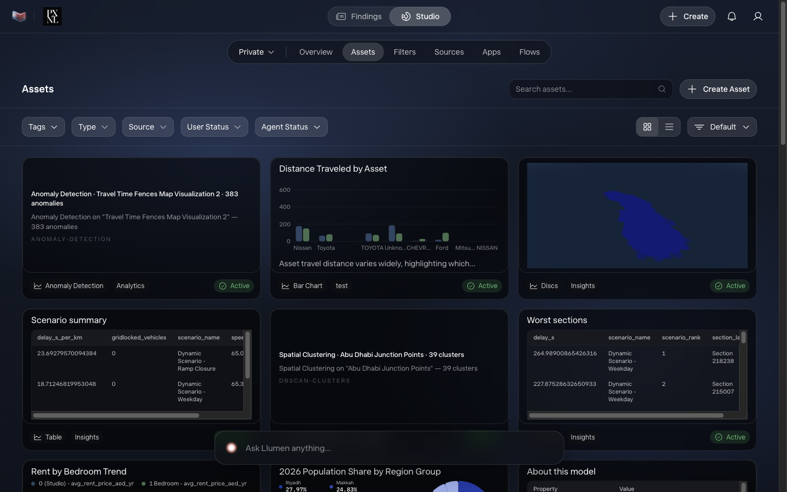
- **Confidence:** Real.

**A-M5. Studio state is not URL- or history-backed**
- **Actual:**
  - Sub-tab clicks update `?tab=` with `replaceState` (`history.length` stayed at 2 across Overview → Assets → Apps). Browser **Back leaves Studio entirely** instead of returning to the previous tab.
  - Search text and page number are lost on reload (typed "Abu Dhabi", went to page 2, reloaded: empty search, page 1).
  - Grid/list view persists across reloads (stored locally).
  - Changing page does not scroll to the top. After clicking "Page 2", `scrollY` stayed at 923, so the user lands at the bottom of the new page.
- **Confidence:** Real. Using `replaceState` for tabs may be deliberate, so that part needs a decision.

**A-M6. Scrollbars break the "hug the edge, 4 px overlay" rule**
- **Actual:**
  - Studio scrolls the **document**. `html`/`body` have `scrollbar-width: auto`, so there is a classic 15 px scrollbar: body width is 1425 at a 1440 viewport.
  - Table previews inside asset cards (`.h-full.w-full.overflow-auto`) render classic scrollbars on **both axes** inside thumbnails ("Worst sections", "Scenario summary", "About this model").
  - The filter dropdown scroller (`.llumen-dropdown-scroll`) sits inside a menu with `padding: 4px`, so the thumb is inset 4 px from the edge and is 11 px wide (`scrollbar-width: thin`) instead of 4 px.
- **Evidence:**

  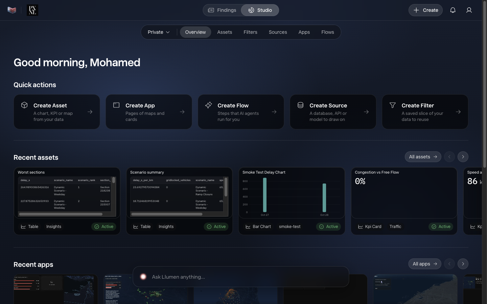
  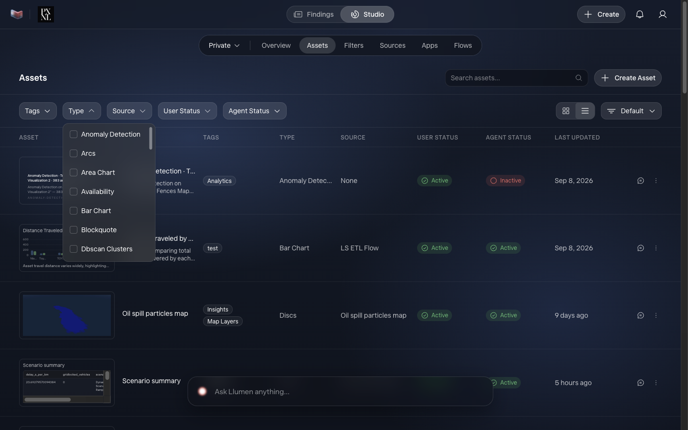
- **Confidence:** Real.

**A-M7. Accessibility gaps in menus and controls**
- **Actual:**
  - The Type filter menu has 37 `role="menuitemcheckbox"` items with **no accessible name**.
  - List-view "More options" buttons are unnamed (25 per page).
  - Create, filter and view-toggle buttons expose no `aria-expanded` or `aria-pressed`.
  - After Escape closes a filter menu, focus is lost instead of returning to the trigger.
  - The view toggle's DOM order (List, Card) is the reverse of its visual order (Card, List), so the tab order does not match what is on screen.
- **Focus-visible (forced) is inconsistent:**
  - Create and sub-nav tabs: `2px solid #60a5fa`, offset 2 px.
  - Filter buttons: no change (only the resting `1px rgba(255,255,255,.1)` outline remains).
  - Pagination: browser default `auto 1px rgb(153,200,255)`.
- **Confidence:** Real. Native Tab traversal could not be exercised (see "Not tested").

### Low

**A-L1. Card "More options" menu and menu surfaces are inconsistent**
- "Delete Asset" uses the same 80 % white as the other items, with no destructive color and no separator before Archive/Delete.
- Staging uses two menu surfaces:
  - Filter dropdowns: `rgba(66,66,66,.5)`, 8 px item radius, 100 % white text.
  - Card and Create menus: Tailwind `zinc-600/80` (oklab 0.44, alpha 0.8), 12 px item radius, 80 % text.
- **Evidence:**

  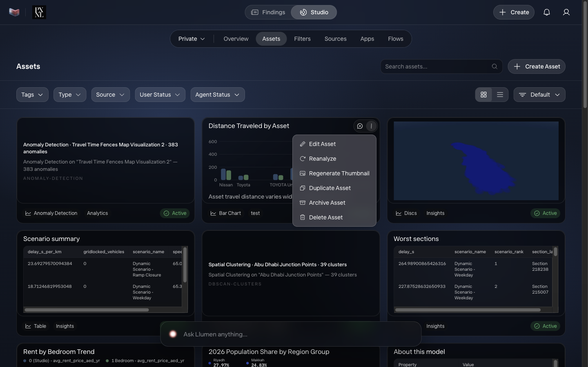

**A-L2. Truncated list cells have no tooltip in two columns.** Asset names truncate with a `title` tooltip. The Type and Source cells truncate with no tooltip, for example "Anomaly Detec…", `DM_area_performance_lumen`, `Saudi_Police_Llumen_Demo_Lumin_Tables_MOI`. The name column is only about 153 px wide at 1440, so most names truncate.

  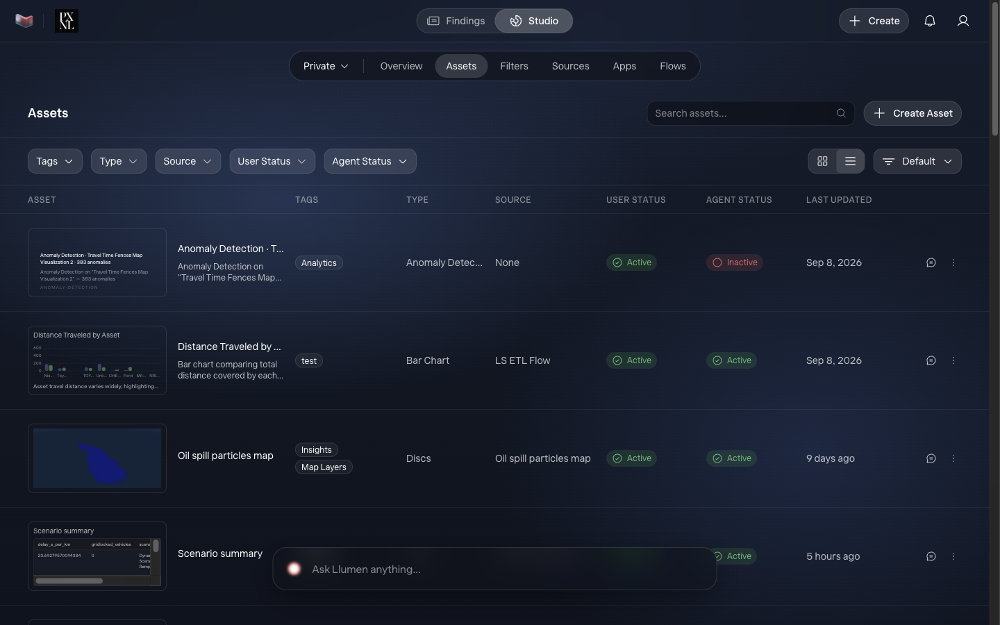

**A-L3. Every type chip uses the same chart icon.** All asset types (Bar, Table, Points, Discs, KPI, Pie, Scatter, Analytics…) use the same SVG path `M232,208…`. Main does the same, so this is shared and low priority.

**A-L4. Analytics result modal polish**
- The thumbnail is a placeholder (large "?" from `/images/thumbnails/placeholder.png`).
- The title casing differs from the card ("383 Anomalies" vs "383 anomalies").
- There are two close controls (X and a full-width Close).
- `/api/storage/asset-thumbnail/:id/url` returns some 404s, which is why placeholders appear.
- **Evidence:** the Analytics modal screenshot under A-M3.

**A-L5. Off-palette blue accent (speculative).** The active pagination page uses a bright blue fill, and so do the Edit wizard's Next button and its active step and sidebar item. Nothing else in Studio uses this accent; the rest is white or neutral. Needs a decision. Evidence: the pagination screenshot under A-H1 and the wizard under A-M3.

**A-L6. Carousel rapid clicks advance unevenly.** Clicking Next again within about 700 ms (mid smooth-scroll) advances only a few pixels or none. At normal speed (about 1.6 s apart) the steps are about 997 px and the disabled states are correct at both ends. Main behaves the same way.

**A-L7. Findings hero has no visual (speculative).** After 5 s the Findings hero area showed no map or visual behind the insight text (plain navy). Main shows a 3D map. It may be data- or slow-load-related.

  | Staging Findings (after 5 s) | Main Briefings |
  |---|---|
  |  | 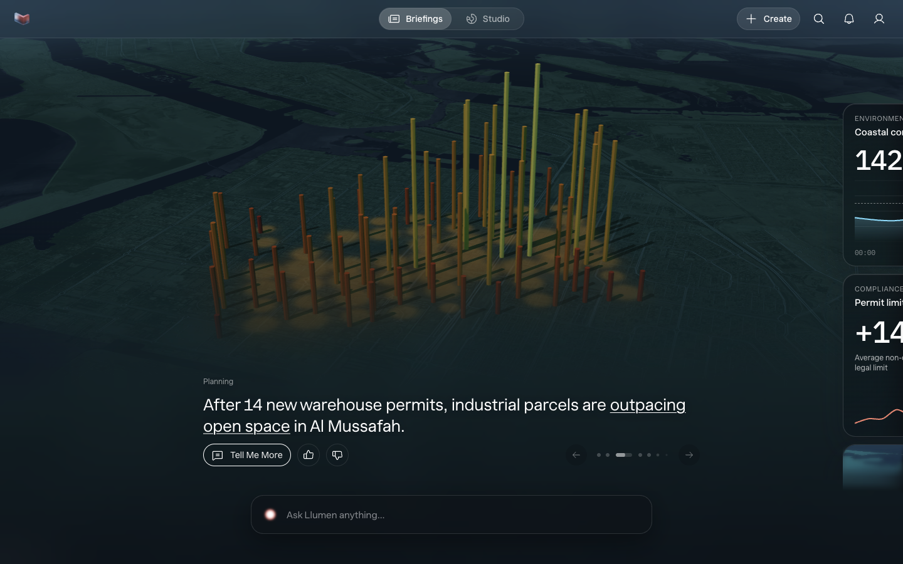 |

**A-L8. Console and network notes**
- The only other console warning was from deck.gl: "The `light` root property is deprecated, prefer using `lights`…".
- No uncaught errors or unhandled rejections were captured.
- The Resource Timing buffer hit its 250-entry limit, so the slow-request picture is partial. The requests that were recorded were fast: assets/content max 217 ms, runner `asset/data` max 275 ms. The slow ones are the about-20 s fusion failures, which surface as `400`.

**A-L9. Card hover lacks Monitor.** Card hover shows only "Add to chat" and "Asset actions" (and "More options" in the grid). There is no "Monitor" action; see Part B.

---

## Part B — Staging vs main design inconsistencies (1440×900)

Mock-data differences are ignored. "Source of truth" is my recommendation.

| Area | Staging | Main | Evidence | Confidence | Suggested source of truth |
|---|---|---|---|---|---|
| Mode switch labels | "Findings / Studio" (226 px, `position:absolute`) | "Briefings / Studio" (232 px) | `staging-overview-1440.png`, `main-overview-1440.png` | Real | Needs decision (naming) |
| Top bar left | Llumen logo + divider + org badge image ("PNVL") | Logo only | same | Real | Staging (real tenant branding) |
| Top bar right | Create · Notifications · Profile ("User Profile") | Create · **Search** · Notifications · Account | same | Real | Main for Search (missing on staging); needs decision |
| Studio sub-nav | "Private ▾" picker + 6 tabs as `role=tab`; nav 593 px | Workspace name pill "Global Sales Operations ▾" + 6 tabs as buttons with `aria-current` + **Settings gear**; nav 758 px. Pill tokens are identical (34 px, 999 px radius, 14 px, active `rgba(255,255,255,.14)`) | same | Real | Main for Settings; staging's `tablist` semantics are better |
| Quick actions | "Create Asset" (Title Case); App copy "Pages of maps and cards" → card height 104 | "Create asset" (sentence case); App copy "A dashboard, slide deck or command room" → 122 (wraps to 3 lines). Same tokens: 18 px radius, `rgba(0,0,0,.56)`, 20 px padding, title 16/600 | same | Real | Main casing (sentence case matches the rest of main) |
| Page scroll container | Document scroll; classic 15 px scrollbar (`scrollbar-width:auto`) | `<main>` scroller, `scrollbar-width:thin` (11 px), `rgba(132,177,245,.14)` thumb, no padding | same | Real | Main (but even main uses 11 px, not the 4 px `--lc-scrollbar-size`) |
| Asset card shell | 16 px radius, 1 px `rgba(255,255,255,.1)` border (`.22` on hover), `rgba(0,0,0,.56)`; `transition: border-color .2s`; card cursor default (overlay button gives pointer) | Same tokens; `transition: border-color .2s, transform .2s` (hover lift); `cursor:pointer` on the card | forced-hover comparison | Real | Main (adds hover motion) |
| Card hover actions | Overview: Add to chat + "Asset actions" (2). Grid: Add to chat + More options | Add to chat + **Monitor** + More options (3) everywhere | forced hover; snapshots | Real | Main (Monitor missing on staging) |
| Card title | HTML `h3` 18 px / 400, line-height 24 | Chart-SVG text 14 px / 400 | computed styles | Real | Needs decision (main is denser and matches the 14 px chip/body scale) |
| Type chip | 12 px, `rgba(48,55,64,.2)`, 999 px radius, 4/8 padding, truncates with ellipsis; label "Kpi Card" | Same tokens, no truncation; label "KPI" | computed styles | Real | Main label casing ("KPI") |
| Status pill | Green "Active" only in cards (agent status shown only in list) | Active / Pending Review (amber) / Inactive (red) in cards | `main-assets-grid-1440.png` | Partly test data | Main (multi-state pill in cards) |
| Card actions on map and analytics assets | No title; analytics cards use a custom text layout | Every card has a title plus chart | A-M4 | Real | Main |
| Assets page header | "Assets" is a `span.panelLabel` (18/600) | `h2` (18/600) | computed styles | Real | Main (semantic heading) |
| Filters bar | Tags · Type · Source · User Status · Agent Status. Button 36 px, 12 px radius, `border:0` + `outline:1px rgba(255,255,255,.1)`, font set on the button 16 px (label 14 px) | Category · Type · Status. Button 36 px, 12 px radius, `border:1px rgba(255,255,255,.1)`, 14/20 | `staging-assets-grid-top-1440.png`, `main-assets-grid-1440.png` | Real (looks nearly identical) | Staging for filter set (real backend); main for implementation |
| Search field | Outline-based border; textbox named by placeholder | 1 px border; `role=searchbox`, label "Search assets" | computed styles | Real | Main |
| View toggle | `List view` / `Card view` buttons, DOM order reversed from visual order, no `aria-pressed` | `radiogroup` Grid / List in visual order | computed styles; snapshot | Real | Main |
| Filter dropdown | Same surface `rgba(66,66,66,.5)`, 12 px radius, 4 px padding, 36 px rows; items unnamed; 37 types and no search | Same surface; `listbox`/`option` with names; `aria-expanded` on the trigger | `staging-type-filter-open-1440.png`, `main-type-filter-open-1440.png` | Real | Main semantics; consider search for long lists |
| Card "More options" menu | 6 items (Edit Asset, Reanalyze, Regenerate Thumbnail, Duplicate, Archive, Delete), zinc-600/80, item radius 12, 80 % text, Delete not red | 3 items (Duplicate, Deactivate, Delete), `rgba(66,66,66,.5)`, item radius 8, Delete `rgb(241,116,116)` | `staging-card-more-options-menu-1440.png`, `main-card-more-options-menu-1440.png` | Real | Main visuals + staging item set |
| Create menu | 120 px wide, zinc-600/80, 12 px radius, light shadow; items Asset / App / **Flow** (all enabled), weight 400, 80 % text | 200 px wide, `rgba(10,16,28,.94)`, 14 px radius, `0 16px 40px rgba(0,0,0,.4)`; items Asset / App "Soon" / **Agent** "Soon", weight 500 | `staging-create-menu-1440.png`, `main-create-menu-1440.png` | Real | Main visuals; item labels need decision (Flow vs Agent) |
| List view | Columns Asset · Tags · Type · Source · User Status · Agent Status · Last Updated (sortable header buttons); row actions Add to chat + unnamed More; name column about 153 px (truncates) | Columns Asset · Category · Type · Status · Last Updated; More only; wide name + description | `staging-assets-list-1440.png`, `main-assets-list-1440.png` | Real | Needs decision (staging has the real columns; main's wider name column reads better) |
| Pagination | Items-per-page + "1–25 of 607" + numbered pager with blue active page | None (14 mock items) | `staging-assets-pagination-1440.png` | Real | Staging (missing on main; define its style in main) |
| Notifications | Popover empty state "No notifications / You're all caught up!" (Escape closes) | Bell is a dead click (no panel) | `staging-notifications-1440.png`, `main-notifications-click-1440.png` | Real | Staging (missing on main) |
| Escape and focus return on menus | Focus is lost after Escape | Focus returns to the trigger | eval | Real | Main |
| Focus-visible rings | Top bar and tabs `2px solid #60a5fa` offset 2; filters none; pager UA default | Top bar and tabs UA default `auto 1px`; filters `2px solid rgb(112,174,255)` offset 2 | forced `:focus-visible` | Real | Needs decision; neither side is consistent (pick one 2 px ring token) |
| Composer | 640 px, 20 px radius, `rgba(14,16,20,.52)`, `blur(20px) saturate(1.6)`, same shadow; editor padding 7/0; Add context only | Identical box; editor padding 7/0/7/4; **Attach file** (disabled) + Add context | computed styles | Real | Main (adds Attach); otherwise matching |
| Font stacks | Three stacks mixed: `"Innovator Grotesk", innovatorGrotesk, …Fallback` / `"Innovator Grotesk", Inter, sans-serif` / `"Innovator Grotesk", sans-serif` | One stack: `"Innovator Grotesk", system-ui, …` | computed styles | Real (invisible while the web font loads correctly) | Main |
| Body background | `rgb(10,10,10)` | `rgb(5,6,10)` | computed styles | Real (mostly covered by the gradient) | Needs decision |
| Findings / Briefings hero | Plain navy behind the insight | 3D map behind the insight | `staging-findings-after-5s-1440.png`, `main-briefings-1440.png` | Speculative (possibly data or slow) | Main |
| 1024 px behaviour | 2-column shelf grid, arrows `display:none`, quick actions 3 + 2 | Same (arrows not rendered) | `staging-overview-1024.png` | Consistent | — |
| Hidden content in the a11y tree (main only) | — | While Studio is shown, the Briefings view (findings carousel, My Board dialog) stays in the accessibility tree | main snapshot | Real (main-only bug) | Staging behaviour |

### Side-by-side screenshots

| Staging | Main |
|---|---|
| **Overview** | |
|  | 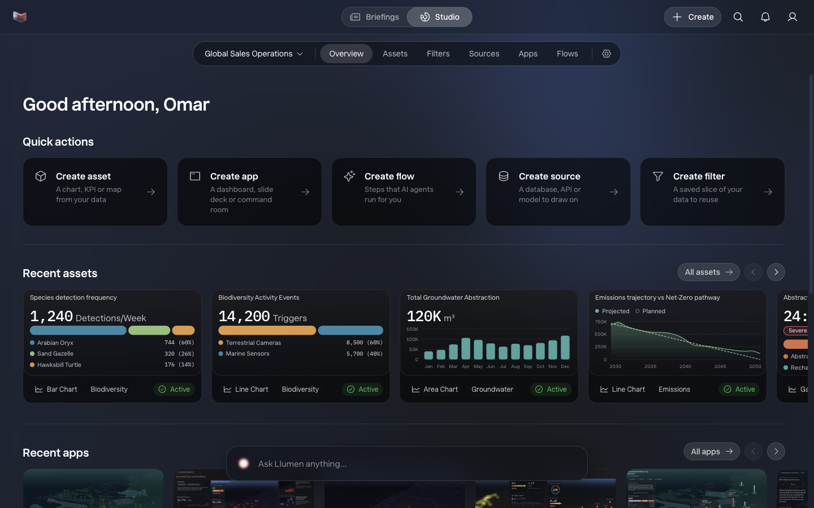 |
| **Assets grid** | |
|  | 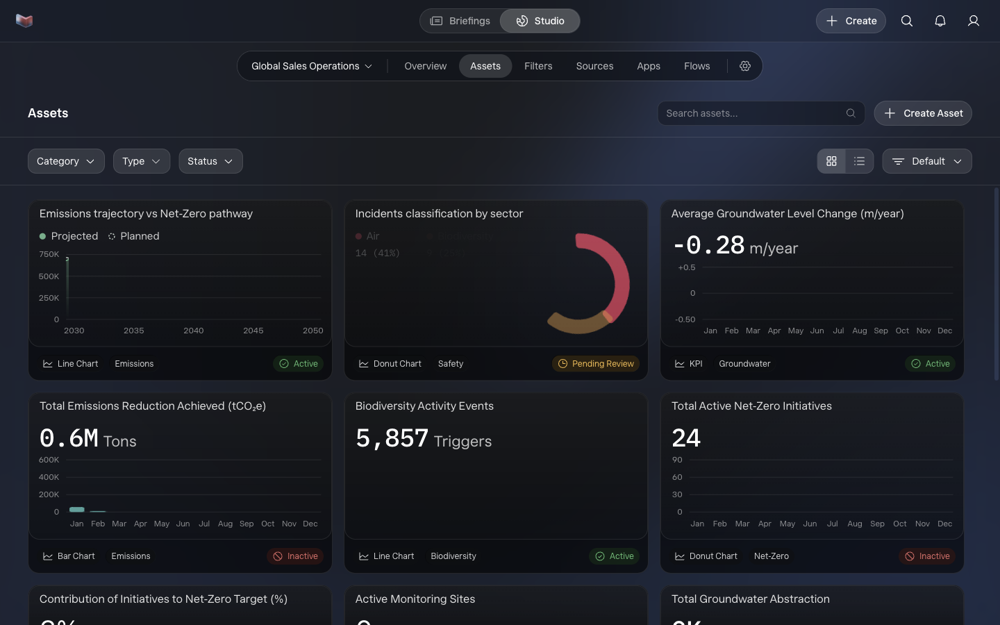 |
| **Assets list** | |
|  |  |
| **Type filter open** | |
|  |  |
| **Card "More options" menu** | |
|  | 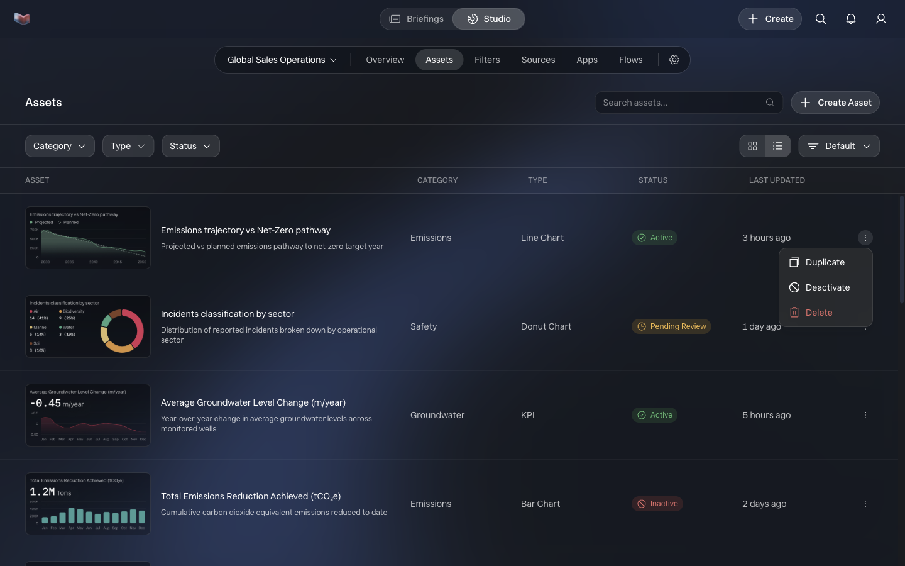 |
| **Create menu** | |
| 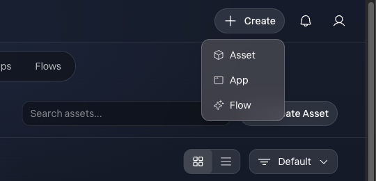 | 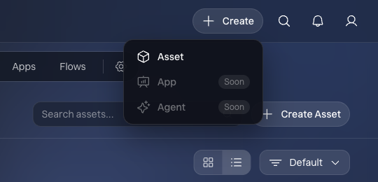 |
| **Notifications** | |
| 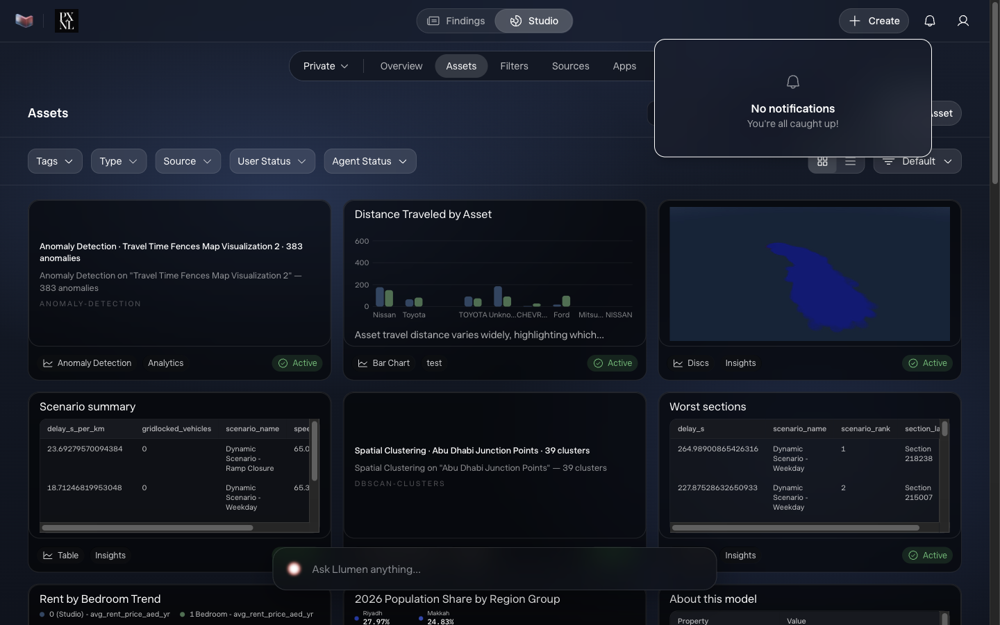 | 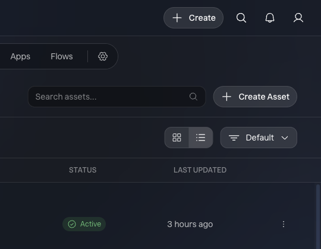 |
| **Findings / Briefings** | |
|  |  |

**Staging only**

| Overview at 1024 px | Assets bottom at 1024 px |
|---|---|
|  |  |

---

## Not tested

- Real keyboard Tab traversal. The key tool sends synthetic DOM key events, so focus doesn't move natively. Focus rings were checked by forcing `:focus-visible` instead.
- Map pan and zoom inside map cards and in the wizard preview.
- Items-per-page change, sort options, selecting filter values, and clicking list column-header sorting.
- Filters, Sources, Apps and Flows tabs; Profile menu; workspace picker.
- Add to chat / Monitor actions and composer submit (these would create data).
- Double-click behaviour.
- Network response bodies and CDP `Log` events. Console output was captured through an in-page wrapper only.
- Main at 768 and 390.
- Staging at 1280 was only checked for layout metrics (nothing broken).
